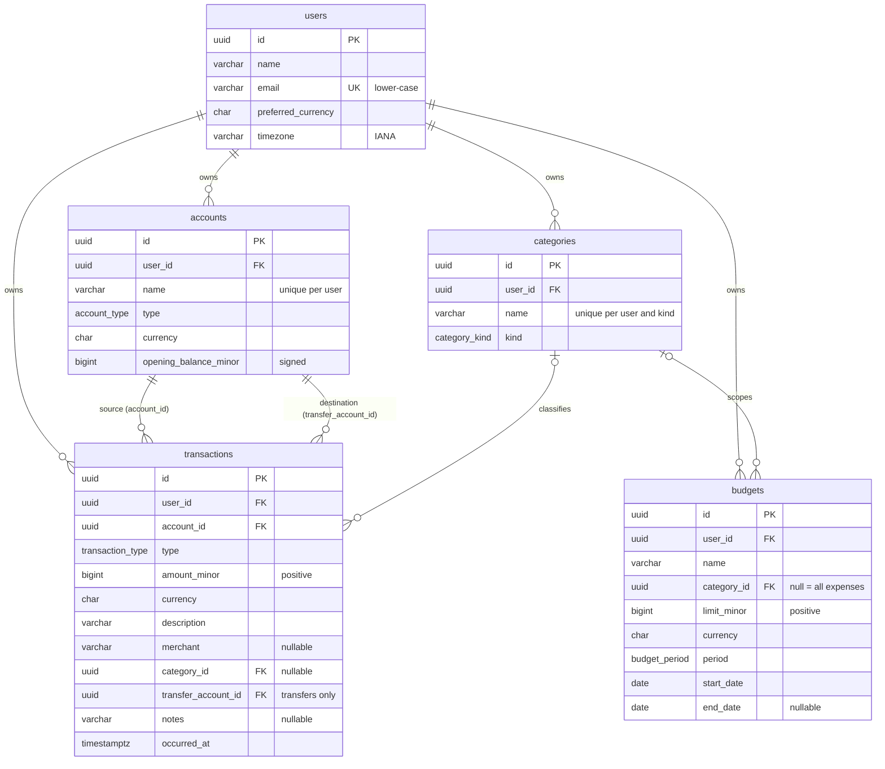

# CalmCash database design

PostgreSQL is the system of record. The schema is defined in
[`prisma/schema.prisma`](../prisma/schema.prisma); the authoritative DDL — including the CHECK
constraints Prisma cannot express — is in [`prisma/migrations/`](../prisma/migrations/).
This document covers the Phase 1 core models.

## 1. Entity relationships



Every table also has `created_at` and `updated_at` (`timestamptz(3)`).

| Model         | Purpose                                                                                        |
| ------------- | ---------------------------------------------------------------------------------------------- |
| `User`        | Owner of all data. Preferred currency and IANA time zone drive defaults and reporting.         |
| `Account`     | A place money lives: bank account, cash, card, wallet, investment, or loan.                    |
| `Category`    | User-defined income or expense label. Added in Phase 1 so `categoryId` has a real foreign key. |
| `Transaction` | One income, expense, or transfer event.                                                        |
| `Budget`      | A spending limit per period, for one category or all expenses.                                 |

### Refinements to the initial contracts

These changes to the originally proposed fields are reflected in the database, the shared DTOs,
and the schemas:

- **`Category` model added** — `Transaction.categoryId` and `Budget.categoryId` reference it, so
  they are real foreign keys rather than free-form identifiers.
- **`Transaction.transferAccountId` added** — the destination of a transfer (see §3).
- **`TransactionDto` is a discriminated union** on `type`: transfers require `transferAccountId`
  and cannot have a `categoryId`; income and expense cannot have a destination.
- **Optional DTO fields are absent rather than `null`** — `merchant`, `notes`, `categoryId`, and
  `Budget.endDate` are omitted from JSON when the column is `NULL`.

## 2. Monetary representation

Money is the most sensitive data in the system, so it follows strict rules:

1. **Integer minor units in `BIGINT`.** Amounts are stored as the number of minor units (paise
   for INR, cents for USD) in `BIGINT` columns: `opening_balance_minor`, `amount_minor`, and
   `limit_minor`. There are no `NUMERIC`, `REAL`, or `DOUBLE PRECISION` money columns.
2. **Never JavaScript `number`.** `BIGINT` exceeds `Number.MAX_SAFE_INTEGER` (2^53 − 1). Prisma
   returns `BigInt` columns as `bigint`, and code computes with `bigint` only. Floating-point
   arithmetic is never used for money: `0.1 + 0.2 !== 0.3`, but `10n + 20n === 30n`.
3. **Decimal strings in JSON.** DTOs carry amounts as canonical base-10 strings (`MinorUnitsString`,
   e.g. `"12550"` for ₹125.50), because JSON numbers are parsed as doubles. Helpers in
   `packages/shared/src/money/minor-units.ts` convert between the two:
   - `serializeMinorUnits(bigint) → string` — API responses.
   - `parseMinorUnits(string) → bigint` / `tryParseMinorUnits` — request input. These reject
     non-canonical input (`"007"`, `"1.5"`, `"+1"`, `"-0"`, …) and anything outside the BIGINT range.
   - `minorUnitsToDecimalString(bigint, currency)` — exact display/export strings (`"125.50"`)
     using string arithmetic, honouring each currency's ISO 4217 exponent (JPY 0, INR 2, KWD 3).
4. **Validated before persistence.** `minorUnitsSchema` and `positiveMinorUnitsSchema` validate
   the string form and range at the API edge; CHECK constraints enforce positivity in the database.
5. **Sign conventions:**

   | Column                  | Sign              | Meaning                                           |
   | ----------------------- | ----------------- | ------------------------------------------------- |
   | `opening_balance_minor` | signed            | Negative for liabilities (credit cards, loans).   |
   | `amount_minor`          | strictly positive | Direction comes from `type`, never from the sign. |
   | `limit_minor`           | strictly positive | Spending ceiling for one period.                  |

6. **Currency on every monetary row.** `currency` is an ISO 4217 code (`CHAR(3)`, upper case,
   enforced by CHECK). The database accepts any well-formed code; the API accepts only codes in
   `CURRENCY_CODES` (`packages/shared/src/constants/currencies.ts`), so supporting a new currency
   needs no migration. Amounts in different currencies are never added together without an
   explicit conversion step (a later phase).

## 3. Transaction types and balance calculation

| `type`     | Effect on `account_id` | Effect on `transfer_account_id`       | Category       | In income/expense reports |
| ---------- | ---------------------- | ------------------------------------- | -------------- | ------------------------- |
| `income`   | + `amount_minor`       | must be `NULL`                        | optional       | yes                       |
| `expense`  | − `amount_minor`       | must be `NULL`                        | optional       | yes                       |
| `transfer` | − `amount_minor`       | + `amount_minor` (required, ≠ source) | must be `NULL` | no                        |

A transfer is **one row**, not a pair of rows. Both sides of the movement are always present
together, and a transfer can never be counted twice or half-recorded. The balance of account `A` is:

```text
balance(A) = opening_balance_minor(A)
           + Σ amount_minor  where account_id = A           and type = 'income'
           − Σ amount_minor  where account_id = A           and type = 'expense'
           − Σ amount_minor  where account_id = A           and type = 'transfer'
           + Σ amount_minor  where transfer_account_id = A  and type = 'transfer'
```

Balances are always derived per account with this formula and with `bigint` (or SQL `BIGINT`/
`NUMERIC` aggregation) — never by summing all of a user's rows, and never across currencies.
Later phases extend the model without changing the rule:

- **Statement imports** will record each row's source and a deduplication fingerprint with a
  unique constraint (for example per account and external reference), so re-importing a statement
  cannot create duplicate transactions.
- **Cross-currency transfers** will add an explicit destination amount and currency instead of
  converting implicitly.

## 4. Integrity rules

### Constraints

| Table          | Constraint                                                 | Rule                                                                           |
| -------------- | ---------------------------------------------------------- | ------------------------------------------------------------------------------ |
| `users`        | `users_email_key` (unique)                                 | One account per e-mail address.                                                |
| `users`        | `users_email_lowercase_check`                              | E-mail stored lower-case, so uniqueness is case-insensitive.                   |
| `accounts`     | `accounts_user_id_name_key` (unique)                       | Account names are unique per user.                                             |
| `categories`   | `categories_user_id_kind_name_key` (unique)                | Category names are unique per user and kind.                                   |
| `transactions` | `transactions_amount_minor_positive_check`                 | `amount_minor > 0`.                                                            |
| `transactions` | `transactions_transfer_shape_check`                        | Transfers: destination present, ≠ source, no category. Others: no destination. |
| `budgets`      | `budgets_limit_minor_positive_check`                       | `limit_minor > 0`.                                                             |
| `budgets`      | `budgets_date_range_check`                                 | `end_date` is null or ≥ `start_date`.                                          |
| `budgets`      | `budgets_custom_period_end_date_check`                     | `custom` periods require an `end_date`.                                        |
| all            | `*_currency_format_check`                                  | `currency ~ '^[A-Z]{3}$'`.                                                     |
| all            | `*_name_not_blank_check` / `*_description_not_blank_check` | Text identifiers cannot be blank.                                              |

These rules are also validated earlier, at the API edge with Zod. The database copy is the last
line of defence against a buggy code path or a manual query.

### Foreign keys and deletion behaviour

| Reference                                     | On delete   | Why                                                                      |
| --------------------------------------------- | ----------- | ------------------------------------------------------------------------ |
| `*.user_id → users`                           | `CASCADE`   | Deleting a user removes all of their data.                               |
| `transactions.account_id → accounts`          | `NO ACTION` | An account with history cannot be deleted directly (archive it instead). |
| `transactions.transfer_account_id → accounts` | `NO ACTION` | Same as above for transfer destinations.                                 |
| `transactions.category_id → categories`       | `SET NULL`  | Deleting a category un-categorises its transactions; amounts are kept.   |
| `budgets.category_id → categories`            | `NO ACTION` | Prevents silently widening a budget to "all categories".                 |

`NO ACTION` is used instead of `RESTRICT` on purpose. The check runs at the end of the statement,
so deleting a user, which cascades to both transactions and accounts, still succeeds, while
deleting a single account that has transactions is rejected.

### Ownership

Every user-owned row carries `user_id`. Services must scope every query by the authenticated user,
and must verify that referenced rows (account, category, transfer destination) belong to the same
user and use the same currency before writing. Composite foreign keys can harden this at the
database level later if needed.

## 5. Keys, time, and indexes

- **Primary keys:** UUIDv7 (`@default(uuid(7))`, PostgreSQL `uuid`). They are time-ordered, so
  B-tree inserts stay local, and they are safe to expose in URLs.
- **Instants:** `timestamptz(3)`, stored in UTC and serialised as ISO 8601 with `Z`
  (`IsoDateTimeString`).
- **Calendar dates:** budget windows use `date` (`IsoDateString`, `YYYY-MM-DD`), interpreted in the
  user's `timezone`.
- **Indexes:**

  | Index                                         | Serves                                               |
  | --------------------------------------------- | ---------------------------------------------------- |
  | `transactions (user_id, occurred_at DESC)`    | A user's timeline, newest first; date-range reports. |
  | `transactions (account_id, occurred_at DESC)` | An account ledger; balance calculation.              |
  | `transactions (transfer_account_id)`          | Incoming transfers for an account's balance.         |
  | `transactions (category_id)`                  | Category reports and `ON DELETE SET NULL`.           |
  | `budgets (user_id)`, `budgets (category_id)`  | A user's budgets; FK checks.                         |
  | unique `accounts (user_id, name)`             | Also serves "accounts of a user".                    |
  | unique `categories (user_id, kind, name)`     | Also serves "categories of a user".                  |

## 6. Database models vs. API DTOs

Prisma models are internal to the API. Responses always go through a mapper into a shared DTO:

| Database (Prisma)                                       | API DTO (`@calmcash/shared`)               |
| ------------------------------------------------------- | ------------------------------------------ |
| `bigint` money columns                                  | `MinorUnitsString` (`serializeMinorUnits`) |
| `Date` (`timestamptz`)                                  | `IsoDateTimeString` (`toISOString()`)      |
| `Date` (`date`)                                         | `IsoDateString` (`YYYY-MM-DD`)             |
| `null` optional column                                  | Property omitted                           |
| Enum values                                             | Identical literals (asserted by a test)    |
| Internal or sensitive columns (e.g. future credentials) | Never present                              |

`apps/api/src/lib/domain-enums.test.ts` asserts that the generated Prisma enums and the shared
literal unions are identical, both at runtime and at the type level.

## 7. Migration workflow

- **Change the schema:** edit `prisma/schema.prisma`, then run
  `pnpm db:migrate --name <change_name>`. This creates and applies a migration.
- **Add custom SQL** (CHECK constraints, partial indexes, data backfills):
  `pnpm exec prisma migrate dev --create-only --name <change_name>`, edit the generated
  `migration.sql`, then `pnpm db:migrate`.
- **Never edit an applied migration.** Add a new migration instead.
- **Production:** `pnpm db:deploy` (`prisma migrate deploy`) applies pending migrations without
  prompting and never resets data.
- **Check for drift:**
  `pnpm exec prisma migrate diff --from-config-datasource --to-schema prisma/schema.prisma --exit-code`
  exits with 0 when the database matches the schema.
