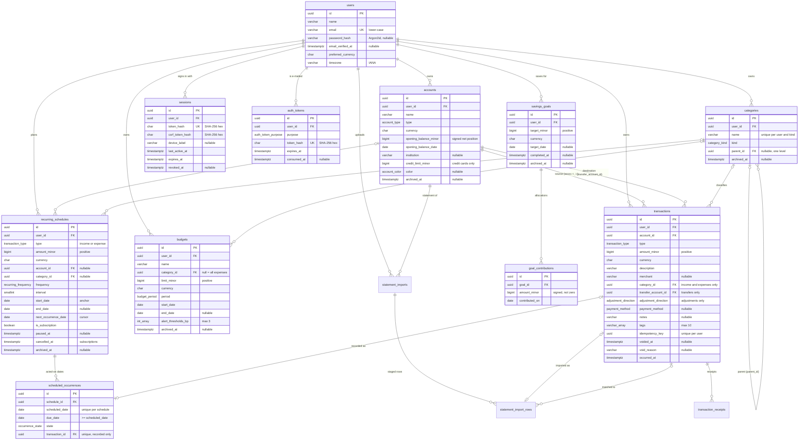

# CalmCash database design

PostgreSQL is the system of record. The schema is defined in
[`prisma/schema.prisma`](../prisma/schema.prisma); the authoritative DDL — including the CHECK
constraints Prisma cannot express — is in [`prisma/migrations/`](../prisma/migrations/).
This document covers the Phase 1 core models, the Phase 3 authentication models, the Phase 4
account-management rules (§3a), the Phase 5 transaction ledger (§3b), the Phase 6 dashboard
metrics (§3c), the Phase 7 planning models (§3d), and the Phase 8 statement imports and receipts
(§3e).

## 1. Entity relationships



Every table also has `created_at` and `updated_at` (`timestamptz(3)`).

| Model                 | Purpose                                                                                         |
| --------------------- | ----------------------------------------------------------------------------------------------- |
| `User`                | Owner of all data. Preferred currency and IANA time zone drive defaults and reporting.          |
| `Account`             | A place money lives (cash, bank, savings, wallet) or a debt (credit card); see §3a.             |
| `Category`            | Income or expense label, two levels deep; defaults provisioned per user (§3b).                  |
| `Transaction`         | One income, expense, transfer, or balance adjustment (§3b).                                     |
| `Budget`              | A spending limit per period, for one category or all expenses (§3d).                            |
| `RecurringSchedule`   | A rule for expected income or spending; subscriptions are flagged schedules (§3d).              |
| `ScheduledOccurrence` | One occurrence a person acted on: recorded, skipped, postponed, or passed over (§3d).           |
| `SavingsGoal`         | A target to save towards; progress is the sum of its contributions (§3d).                       |
| `GoalContribution`    | A planning allocation towards a goal; never a transaction (§3d).                                |
| `Session`             | A browser session: hashed cookie token, hashed CSRF token, lifetime, revocation (Phase 3).      |
| `AuthToken`           | A single-use e-mailed token for e-mail verification or password reset, stored hashed (Phase 3). |

### Refinements to the initial contracts

These changes to the originally proposed fields are reflected in the database, the shared DTOs,
and the schemas:

- **`Category` model added** — `Transaction.categoryId` and `Budget.categoryId` reference it, so
  they are real foreign keys rather than free-form identifiers.
- **`Transaction.transferAccountId` added** — the destination of a transfer (see §3).
- **`TransactionDto` is a discriminated union** on `type`: transfers require `transferAccountId`
  and cannot have a `categoryId`; income and expense cannot have a destination.
- **Optional DTO fields are absent rather than `null`** — `merchant`, `notes`, `categoryId`, and
  `Budget.endDate` are omitted from JSON when the column is `NULL`.

## 2. Monetary representation

Money is the most sensitive data in the system, so it follows strict rules:

1. **Integer minor units in `BIGINT`.** Amounts are stored as the number of minor units (paise
   for INR, cents for USD) in `BIGINT` columns: `opening_balance_minor`, `amount_minor`, and
   `limit_minor`, `credit_limit_minor`. There are no `NUMERIC`, `REAL`, or `DOUBLE PRECISION` money columns.
2. **Never JavaScript `number`.** `BIGINT` exceeds `Number.MAX_SAFE_INTEGER` (2^53 − 1). Prisma
   returns `BigInt` columns as `bigint`, and code computes with `bigint` only. Floating-point
   arithmetic is never used for money: `0.1 + 0.2 !== 0.3`, but `10n + 20n === 30n`.
3. **Decimal strings in JSON.** DTOs carry amounts as canonical base-10 strings (`MinorUnitsString`,
   e.g. `"12550"` for ₹125.50), because JSON numbers are parsed as doubles. Helpers in
   `packages/shared/src/money/minor-units.ts` convert between the two:
   - `serializeMinorUnits(bigint) → string` — API responses.
   - `parseMinorUnits(string) → bigint` / `tryParseMinorUnits` — request input. These reject
     non-canonical input (`"007"`, `"1.5"`, `"+1"`, `"-0"`, …) and anything outside the BIGINT range.
   - `minorUnitsToDecimalString(bigint, currency)` — exact display/export strings (`"125.50"`)
     using string arithmetic, honouring each currency's ISO 4217 exponent (JPY 0, INR 2, KWD 3).
4. **Validated before persistence.** `minorUnitsSchema` and `positiveMinorUnitsSchema` validate
   the string form and range at the API edge; CHECK constraints enforce positivity in the database.
5. **Sign conventions:**

   | Column                  | Sign              | Meaning                                           |
   | ----------------------- | ----------------- | ------------------------------------------------- |
   | `opening_balance_minor` | signed            | Net position: negative = owed (cards, overdraft). |
   | `credit_limit_minor`    | strictly positive | Credit cards only.                                |
   | `amount_minor`          | strictly positive | Direction comes from `type`, never from the sign. |
   | `limit_minor`           | strictly positive | Spending ceiling for one period.                  |

6. **Currency on every monetary row.** `currency` is an ISO 4217 code (`CHAR(3)`, upper case,
   enforced by CHECK). The database accepts any well-formed code; the API accepts only codes in
   `CURRENCY_CODES` (`packages/shared/src/constants/currencies.ts`), so supporting a new currency
   needs no migration. Amounts in different currencies are never added together without an
   explicit conversion step (a later phase).
7. **Exact input.** People type major units ("12,500.50"); `parseDecimalAmount` in
   `packages/shared/src/money/decimal-input.ts` converts them to minor units with the currency's
   exponent and **rejects** extra decimal places instead of rounding (`10.005` INR, `10.5` JPY).
   Entered amounts are limited to ±999,999,999,999,999 minor units (`MAX_ENTERED_AMOUNT_MINOR`),
   so sums of many of them stay far inside `BIGINT`.

## 3. Transaction types and balance calculation

| `type`               | Effect on `account_id`                     | Effect on `transfer_account_id`       | Category                  | In income/expense reports |
| -------------------- | ------------------------------------------ | ------------------------------------- | ------------------------- | ------------------------- |
| `income`             | + `amount_minor`                           | must be `NULL`                        | required (API), `income`  | yes                       |
| `expense`            | − `amount_minor`                           | must be `NULL`                        | required (API), `expense` | yes                       |
| `transfer`           | − `amount_minor`                           | + `amount_minor` (required, ≠ source) | must be `NULL`            | no                        |
| `balance_adjustment` | ± `amount_minor` by `adjustment_direction` | must be `NULL`                        | must be `NULL`            | no                        |

A transfer is **one row**, not a pair of rows. Both sides of the movement are always present
together, and a transfer can never be counted twice or half-recorded. Voided rows (`voided_at` set)
count toward nothing. The balance of account `A` is:

```text
balance(A) = opening_balance_minor(A)
           + Σ amount_minor  where account_id = A           and type = 'income'
           − Σ amount_minor  where account_id = A           and type = 'expense'
           − Σ amount_minor  where account_id = A           and type = 'transfer'
           + Σ amount_minor  where transfer_account_id = A  and type = 'transfer'
           + Σ amount_minor  where account_id = A           and type = 'balance_adjustment' and direction = 'increase'
           − Σ amount_minor  where account_id = A           and type = 'balance_adjustment' and direction = 'decrease'
  (only rows with voided_at IS NULL)
```

Balances are always derived per account with this formula and with `bigint` (or SQL `BIGINT`/
`NUMERIC` aggregation) — never by summing all of a user's rows, and never across currencies.
Later phases extend the model without changing the rule:

- **Statement imports** will record each row's source and a deduplication fingerprint with a
  unique constraint (for example per account and external reference), so re-importing a statement
  cannot create duplicate transactions.
- **Cross-currency transfers** will add an explicit destination amount and currency instead of
  converting implicitly. Phase 5 rejects transfers between accounts of different currencies.

## 3a. Accounts and balance semantics (Phase 4)

### Account types

| `type`           | Classification | Created in the app | Balance may be negative    | Credit limit |
| ---------------- | -------------- | ------------------ | -------------------------- | ------------ |
| `cash`           | asset          | yes                | no                         | no           |
| `bank`           | asset          | yes                | yes (overdraft)            | no           |
| `savings`        | asset          | yes                | no                         | no           |
| `digital_wallet` | asset          | yes                | no                         | no           |
| `credit_card`    | liability      | yes                | yes (that is what is owed) | optional     |
| `other`          | asset          | yes                | yes                        | no           |
| `investment`     | asset          | no (Phase 1 value) | yes                        | no           |
| `loan`           | liability      | no (Phase 1 value) | yes                        | no           |

`CREATABLE_ACCOUNT_TYPES` and `ACCOUNT_TYPE_CLASSIFICATION` in
`packages/shared/src/constants/accounts.ts` are the single source of these rules. `investment` and
`loan` stay in the enum for compatibility; tracking them belongs to later phases. Only the bank or
provider _name_ is stored (`institution`) — never account numbers, card numbers, or credentials.

### One sign convention: the net position

Every balance — opening or current, for every type — is a **signed net position** in minor units:
positive means money held (or a card in credit), negative means money owed.

| Example                                   | `opening_balance_minor` | Shown as                                      |
| ----------------------------------------- | ----------------------- | --------------------------------------------- |
| Savings account with ₹12,500.50           | `1250050`               | Balance ₹12,500.50                            |
| Bank account overdrawn by ₹2,000          | `-200000`               | Overdrawn ₹2,000.00                           |
| Credit card owing ₹12,500 (limit ₹1 lakh) | `-1250000`              | Amount owed ₹12,500.00 · ₹87,500.00 available |

With one convention, one formula serves every account, and a transfer is always money leaving one
balance and entering another. `classification` (in every `AccountDto`) tells clients how to present
it: liabilities report `amountOwedMinor` (the negated position) and, for credit cards with a limit,
`availableCreditMinor = limit − owed` (negative when over the limit). The web form asks credit cards
for the _amount owed_ as a positive number and stores its negation.

**Never one ambiguous total.** Totals are per currency and keep assets (`assetsMinor`, money held;
an overdraft reduces it) and liabilities (`liabilitiesMinor`, money owed; a card in credit reduces
it) side by side. They are never netted into a "balance", and currencies are never added together.

### Opening balance and current balance

- `opening_balance_minor` is the net position **at the start of** `opening_balance_date`, a calendar
  date interpreted in the owner's time zone (`users.timezone`). It is required when an account is
  created, so zero is always deliberate; the date defaults to today and cannot be in the future.
- **Current balance** = opening balance + the signed effect of every _counted_ transaction:

  ```text
  current(A) = opening_balance_minor(A)
             + Σ income              on A
             − Σ expense             on A
             − Σ transfer            where A is the source        (account_id = A)
             + Σ transfer            where A is the destination   (transfer_account_id = A)
             + Σ adjustment ↑        on A   (balance_adjustment, direction increase)
             − Σ adjustment ↓        on A   (balance_adjustment, direction decrease)
  ```

  A transaction counts when it belongs to the account's owner, has the account's currency, is not
  voided, and its `occurred_at` is on or after the start of the opening date in the owner's time
  zone. Earlier rows are history from before tracking began (the Phase 5 API refuses to record
  them). Transfers only move money and adjustments only correct a balance; neither ever counts as
  income or spending. Archived accounts keep computing their balance from their history.

- The arithmetic lives only in `apps/api/src/modules/accounts/account-balance.ts` (pure, tested).
  `account-ledger.ts` (`queryMovementTotals`) supplies per-account sums in **one aggregate query**
  for the user, optionally up to an instant (`asOf`, used by reconciliation), and works inside a
  write's database transaction (`SUM` over `BIGINT` yields `NUMERIC`, returned as text and parsed to
  `bigint`, so no step can overflow or round). Nothing else calculates balances: controllers and the
  web app only display them. If the owner later changes their time zone, the start of the opening
  date moves with it.

### Opening-balance corrections

Until any transaction uses the account (as source or destination), the opening balance, its date,
and the currency can be corrected freely; a currency change must restate the opening balance and
credit limit in the new currency. **Once a transaction exists, those three fields are locked**
(`409 CONFLICT`), because changing them would silently change which transactions count and what
the history means; a voided transaction keeps them locked too, because it can be restored. To
correct a balance once history exists, record a **balance adjustment** (§3b); the opening balance is
never overwritten. Edits run in a database transaction that first locks the account row
(`lockAccounts`, `SELECT … FOR UPDATE`), the same lock every transaction write takes, so the "has
transactions" decision cannot go stale. Other details (name, provider, colour, and type within the
same classification) stay editable — except that an account whose _current_ balance is below zero
cannot become a type that must never be negative (cash, savings, wallet), a gap closed in Phase 5
now that transactions can move the balance.

### Archiving

`archived_at` marks an account as archived: it leaves the default list and the summary, cannot be
edited until restored, cannot receive new transactions, and its existing transactions are
read-only (no edit, void, or restore) until the account is restored. Nothing reactivates an account
implicitly. Nothing is deleted —
transactions, opening balance, and balance stay intact, and restoring returns the account as it was.
Archive and restore are idempotent (repeating them changes nothing and returns the same state).
There is no hard delete: `transactions.account_id` uses `NO ACTION`, so an account with history can
never be removed while its user exists.

### Names are not unique

Phase 1 had a unique `(user_id, name)` constraint. Phase 4 removes it: two accounts may legitimately
share a name ("Cash" at home and in a wallet, two banks' "Credit card"), and an archived account's
name must be reusable. The UI tells accounts apart by type, provider, and currency. The index
`(user_id, archived_at)` replaces it for "accounts of a user" lookups by status.

## 3b. Transactions, categories, and tags (Phase 5)

### What a transaction records

| Field                      | Meaning                                                                                                          |
| -------------------------- | ---------------------------------------------------------------------------------------------------------------- |
| `description`              | What it was for. For adjustments: the reason (required). Transfers default to "Transfer between accounts".       |
| `merchant`                 | Counterparty: merchant or recipient of an expense, payer of income. Never on transfers/adjustments.              |
| `category_id`              | Required by the API for income and expenses (a category of the matching kind); null otherwise.                   |
| `payment_method`           | Optional on income, expenses, and transfers; never on adjustments.                                               |
| `adjustment_direction`     | `increase` or `decrease` of the signed net position; adjustments only.                                           |
| `tags`                     | Up to 10 normalised labels (`varchar(32)[]`).                                                                    |
| `notes`                    | Optional free text (line breaks allowed).                                                                        |
| `currency`                 | Always the account's currency (set by the API, never by the client).                                             |
| `occurred_at`              | UTC instant; not on a future calendar day and not before any involved account's opening date (user's time zone). |
| `idempotency_key`          | Client key of the request that created the row (see below); never exposed.                                       |
| `voided_at`, `void_reason` | Soft deletion (see below).                                                                                       |

The request contracts are discriminated on `type` (`createTransactionInputSchema`): a field another
type uses is **rejected**, not ignored. A partial update (`PATCH`) is merged with the stored row and
the result must be a complete, valid transaction of its (possibly new) type, so changing an expense
into a transfer requires `merchant: null` and `categoryId: null`.

### Balance adjustments (reconciliation)

When the balance a bank, cash count, or statement shows differs from CalmCash's, the person enters
the observed balance (for a card: the amount owed, which the client negates into the signed net
position). The API compares it with the account's balance **at the same instant**
(`queryMovementTotals(…, { asOf })`), and `adjustmentBetween` returns `{ direction, amountMinor }`
with a positive amount. Recording it requires the signed change the person confirmed
(`expectedAdjustmentMinor`); if the balance moved since the preview, nothing is recorded (409). The
opening balance and history never change. For a liability, `decrease` means _more owed_.

### Voiding

`DELETE` does not exist for transactions. Voiding sets `voided_at` (and an optional reason); the
row, its accounts, category, and tags stay, but it counts toward no balance, list (by default), or
total. Restoring clears `voided_at`. Both are idempotent: repeating them changes nothing, so an
effect can never be reversed twice. A transfer is one row, so it is always voided whole. Voiding and
restoring run the same locks and balance checks as any write (voiding income that cash was spent
from would take the cash negative and is refused).

### Idempotency

`POST /transactions` and `POST /transactions/reconciliations` accept an `Idempotency-Key` header (a
UUID). The key is stored with the row under a unique `(user_id, idempotency_key)` index. A retry
with the same key returns the original transaction (`200`) instead of recording it again; a key
reused for a different movement is refused (`409`). Concurrent retries serialise on the account lock
and see the first row; if two still race, the unique index decides and the loser returns the winner.
The web client keeps one key per open form, so a retry after a lost response can never duplicate.

### Categories

Categories form a two-level tree (`parent_id`; one level, same user and kind — API-enforced).
Every user gets a default set on first use (`GET /categories` or `POST /categories` call
`ensureDefaults`), created with `INSERT … ON CONFLICT DO NOTHING` against the existing unique
`(user_id, kind, name)`, so concurrent first requests never duplicate anything and later requests
create nothing. Names are therefore unique per user and kind across the tree (subcategories use
specific names). Only the name can change; kind and position are fixed so history is never moved
between income and spending. Archiving (`archived_at`, cascades to subcategories) hides a category
from new transactions while past transactions and budgets keep it; nothing is ever deleted, so the
`SET NULL` and `NO ACTION` rules below are never triggered by the API.

### Tags

Tags live on the transaction (`varchar(32)[]`, GIN-indexed): a user's tags are exactly the tags on
their own transactions, so ownership needs no extra table. They are normalised the same way in the
web app and the API (`normalizeTag`: trimmed, lower case, spaces become hyphens; letters, marks,
digits, `-`, `_`), de-duplicated, and at most 10 per transaction. Filters match transactions that
carry **all** of the requested tags.

### Locking and concurrency

Every write that can change a balance runs in one database transaction (`TransactionsRepository.inLedger`):

1. lock the transaction row(s) being changed (`SELECT … FOR UPDATE`, ID order);
2. lock every account the old and new versions touch (`lockAccounts`: `… ORDER BY id FOR UPDATE`),
   reading each account's counting start with the same SQL the balance query uses;
3. check ownership, archived state, currency, dates, and category against the locked rows;
4. read the balances, write, read them again (all through `queryMovementTotals` in the same
   transaction), and refuse the write if a cash, savings, or wallet account would end below zero and
   lower than before (`breaksNonNegativeRule`);
5. commit — or roll everything back on any error, so no account ever sees half a transfer.

Locks are always taken in the same global order (transaction rows, then accounts, each by ID), so
concurrent writes queue instead of deadlocking. Account edits from Phase 4 take the same account
lock. Category and tag bulk changes lock the transaction rows (and the accounts, to enforce the
archived rule). Integration tests fire parallel requests on separate connections to prove that
simultaneous spending cannot overdraw cash and that crossing transfers neither deadlock nor lose
money; removing the lock makes the first of those tests fail.

## 3c. Dashboard metrics (Phase 6)

All dashboard figures are read-only aggregates over the tables above; Phase 6 adds no table, column,
index, or migration.

### What counts as cash flow

One SQL fragment, `cashFlowScope` in `apps/api/src/modules/dashboard/dashboard.repository.ts`,
defines it for every dashboard query:

- the caller's rows only (`user_id`), in **one** currency;
- `voided_at IS NULL` — voided rows never count;
- type in `CASH_FLOW_TRANSACTION_TYPES` (`income`, `expense`) — **transfers** move money between the
  user's own accounts and **balance adjustments** correct a balance; neither is income or spending;
- `occurred_at` in a half-open window `[start of from, start of the day after to)`, both instants
  computed with `startOfDayInTimeZone` in the user's time zone. A purchase at 23:59 local time on
  31 March is March, even when that instant is already April in UTC (and vice versa).

The Phase 5 transaction summary uses the same `CASH_FLOW_TRANSACTION_TYPES`, and an integration test
checks that both report the same totals for the same period.

### Metric definitions

| Metric             | Definition                                                                                                                                                                                                                   |
| ------------------ | ---------------------------------------------------------------------------------------------------------------------------------------------------------------------------------------------------------------------------- |
| Money held / owed  | The accounts module's summary of **active** accounts, per currency (§3a). Current, not period-bound.                                                                                                                         |
| Income / expenses  | `SUM(amount_minor)` of cash-flow rows of that type in the period.                                                                                                                                                            |
| Net cash flow      | Income − expenses (may be negative).                                                                                                                                                                                         |
| Savings rate       | (income − expenses) ÷ income, in basis points, rounded half away from zero; **unavailable** (`no_income`) when income is 0. Never clamped: overspending gives a negative rate.                                               |
| Change vs previous | (current − previous) ÷ previous per metric; **unavailable** (`no_previous_value`) when the previous value is 0. The whole comparison is unavailable (`no_previous_activity`) when the previous period has no cash-flow rows. |
| Category share     | Category spend ÷ total spend, each rounded on its own (shares may sum to 99.99–100.01 %).                                                                                                                                    |

All arithmetic is `bigint` (`packages/shared/src/analytics/ratios.ts`); only the browser rounds again,
to one decimal place, for display.

### Periods

- **Presets** in the user's calendar: this month (1st → today), last month (whole), last 3 and
  6 months (from the 1st of the month, 2 or 5 months back → today), this year (1 Jan → today).
- **Previous period**: a preset shifts back by its length in calendar months, keeping partial
  periods partial (1–27 Oct ↔ 1–27 Sep) and whole months whole (if the end is a month's last day, so
  is the previous end: all of March ↔ all of February). A custom range compares with the same
  number of days immediately before it.
- **Trend buckets**: `date_trunc(unit, occurred_at AT TIME ZONE tz)` — days up to 45 days, ISO weeks
  (Monday) up to 190, months up to 1,100, years beyond. Buckets cut by the range are marked
  `partial`; buckets without activity are filled with zeros by the API, never omitted.

### Categories

Expenses roll up to their top-level category (`COALESCE(c.parent_id, c.id)`): a "Food › Delivery"
expense counts towards Food. Both category joins repeat `user_id = t.user_id`, so another user's
category can never be matched. Rows without a category become **Uncategorised** (only when such
rows exist). The six largest are listed; the rest are summed exactly into **Other**, unless only one
is left, which is then shown by name. Archived categories keep their history and are flagged.

### Query cost

Each endpoint runs a fixed number of aggregate queries regardless of data size (no N+1): the
overview runs the account-currency list, an `EXISTS`, the accounts summary, and one totals query
that covers both periods (a `VALUES` list of windows joined to the rows). The trend and category
endpoints each run one aggregate plus the currency list.

Every query filters on `user_id` and an `occurred_at` range, which is exactly the existing
`transactions (user_id, occurred_at DESC)` index. Checked with `EXPLAIN ANALYZE` on a 500,000-row
clone of the table (200 users; one user with ~1,400 rows in the month): both the trend and the
two-window totals query use a bitmap scan of `transactions_user_id_occurred_at_idx` with both bounds
as index conditions, in 5–8 ms. No new index is needed; a covering index can be considered if
very long histories make the heap reads dominant.

## 3d. Budgets, recurring schedules, subscriptions, and goals (Phase 7)

Phase 7 adds planning on top of the ledger. Nothing in it changes how balances or cash flow are
calculated, and none of it stores a running total that could drift from the transactions.

### Budgets: periods

| `period`    | Period shown for a reference date (user's time zone)        |
| ----------- | ----------------------------------------------------------- |
| `weekly`    | The ISO week (Monday–Sunday) containing it                  |
| `monthly`   | The calendar month containing it (never "30 days")          |
| `quarterly` | The calendar quarter (Jan, Apr, Jul, Oct) containing it     |
| `yearly`    | The calendar year containing it                             |
| `custom`    | Always its one range, `start_date` to `end_date` (required) |

A recurring budget continues every period until its optional `end_date`. The shown period is
clipped to `start_date` and `end_date` (flagged `partial`); before the budget starts it shows its
first period (`timing: upcoming`, status `not_applicable`), after it ends its last one
(`timing: ended`, so final results stay visible). The reference date is today unless `?date=` is
given. `budgetWindow` and `budgetPeriodContaining` in `packages/shared/src/planning` are the single
definition, unit-tested for month ends and leap years.

### Budgets: actual spending

Spending is aggregated from `transactions` on every read (`BudgetsRepository.spending`):

- the owner's rows in the budget's **currency** only (never converted or added across currencies);
- `type = 'expense'` and `voided_at IS NULL` — income, transfers, balance adjustments, and voided
  rows never count; credit-card expenses count like any other expense (spending is not a balance
  change, so balances are never compared);
- `occurred_at` in `[start of from, start of the day after to)` in the user's time zone, exactly as
  the dashboard's `cashFlowScope`;
- **category roll-up**: a budget on a top-level category counts expenses in that category and its
  subcategories; a budget on a subcategory counts only that subcategory. Every expense has one
  category, so it is counted once per budget. An overall budget (`category_id` NULL) counts every
  expense in the currency, uncategorised legacy rows included.

Archived categories keep counting for the budgets that use them (history); new budgets cannot pick
an archived or income category. Edits, voids, restores, and category changes of transactions are
reflected immediately because nothing is cached.

### Budgets: progress and status

- `remaining = limit − spent` (negative when overspent, never clamped).
- `used = spent ÷ limit` in basis points, rounded half away from zero only for the reported figure
  and uncapped (125 % is 12 500 bp). Without a positive limit it is `unavailable` (`no_limit`).
- Alert thresholds (`alert_thresholds_bp`): up to three, strictly ascending, 1 %–99 % (CHECK
  constraint for count and range; order by the API). Default `[8000]`; `[]` turns early alerts off.
- Status, decided by **exact** comparisons (79.996 % has not reached an 80 % alert):
  `over_budget` (spent > limit), `limit_reached` (spent = limit), `approaching_limit` (spent ≥ a
  threshold), `on_track`, and `not_applicable` (period not started). On the budget pages alerts
  are derived on every read, so page loads never create anything; since Phase 9 the worker stores
  and sends each threshold alert once per budget period (§3f).
- **No double counting in totals.** One active budget per scope, currency, and period may cover a
  given day (overlaps are refused with `409`, checked under a per-user advisory lock). Summary totals
  per cadence use the overall budget when one exists, otherwise the category budgets except a
  subcategory budget whose parent is also budgeted — the remaining scopes are disjoint. Custom
  budgets appear in status counts but not in cadence totals.

### Recurring schedules and occurrences

A schedule is a rule (`frequency` × `interval` from `start_date`), not money. Dates are calendar
dates in the user's time zone, so daylight-saving changes cannot move them.

- **Month ends.** Every occurrence is computed from the anchor date: a schedule on the 31st falls on
  the last day of shorter months (28/29 Feb, 30 Apr) and returns to the 31st afterwards; 29 February
  falls on 28 February in common years. A date never rolls into the next month.
- **Identity.** An occurrence is identified by its schedule and **scheduled date**. Only
  occurrences someone acted on are stored (`scheduled_occurrences`, unique on
  `(schedule_id, scheduled_date)`); every other date of the rule is pending. A postponed occurrence
  keeps its scheduled date and gets a later `due_date`.
- **States.** Stored: `postponed`, `recorded` (with a unique `transaction_id`), `skipped`, `paused`
  (fell while the schedule was paused). Shown: `upcoming`, `due` (today), `overdue`, `recorded`,
  `skipped`, `paused`; pending ones also report `postponed` and `dueSoon` (within `reminder_days`).
- **Cursor.** `next_occurrence_date` is the earliest occurrence from `start_date` that no row
  resolves; it is recomputed under the schedule's row lock after every change. Rows before the
  start date are history from an earlier timing.
- **Recording** (`…/occurrences/:date/record`), all in one database transaction: lock the schedule
  row; if the occurrence is already recorded, return its transaction (200, nothing written); refuse
  skipped ones (409 — "Expect it after all" first) and schedules changed since they were read;
  record the transaction through the transactions module (account locks, ownership, archived
  accounts refused, date rules, category kind, and the cash/savings/wallet non-negative rule); store
  the occurrence as `recorded`; advance the cursor. Any failure rolls everything back. Concurrent
  confirmations queue on the schedule lock and the later ones see the first transaction; the unique
  indexes on `(schedule_id, scheduled_date)` and `transaction_id` are the last line of defence.
  Integration tests fire six simultaneous confirmations (one 201, five 200, one transaction) and
  inject a failure after the transaction insert (nothing remains).
- **Voiding** a recorded transaction keeps the occurrence recorded (with `transactionStatus:
voided`); restoring the transaction is the way back, so one cycle can never hold two active
  transactions.
- **Skip / unskip / postpone.** Skipping stores `skipped` (idempotent); unskip removes it;
  postponing moves the due date later (at most a year after the scheduled date). Actions reach at
  most a year ahead.
- **Pause / resume.** While paused nothing is expected. On resume, occurrences whose scheduled date
  fell from the pause day up to yesterday are stored as `paused` (not owed); ones already overdue
  before the pause stay expected.
- **Edits.** Amount, account, category, and texts apply to every occurrence not yet recorded;
  recorded transactions never change. A timing change (`frequency`, `interval`, `start_date`)
  restarts the schedule from the new start date, which must come after every recorded or skipped
  occurrence; postponed rows are dropped. `end` sets the last date (not before recorded history)
  and drops later postponements; a schedule with nothing left to expect is `completed`.
- **No scheduler for states.** Due and overdue states are derived per request from persisted
  rules; nothing is ever recorded automatically. Since Phase 9 the worker reads these states to send
  reminders (§3f) but never changes them.

### Subscriptions

A subscription is a recurring **expense** schedule with `is_subscription = true` (CHECK), so it
uses the same recurrence, occurrences, and recording. A subscription can exist without an account
(tracked only; the account is chosen when a charge is recorded). Cancelling sets `cancelled_at` and
an `end_date` (default today; CHECK requires it): charges due up to that date stay expected,
nothing after it is, and recorded charges are untouched. Estimates multiply the expected amount by
the number of pending occurrences in a window (next 30 days, next twelve months) per currency; they
are labelled as estimates and never presented as spending. Nothing is detected automatically.

### Savings goals

- Progress is `saved = Σ goal_contributions.amount_minor` (never negative — enforced under the
  goal's row lock), `remaining = target − saved` (negative once exceeded), and `percent = saved ÷
target` in basis points, uncapped (`no_target` when unavailable). With a target date the API adds
  days remaining and the monthly amount needed (rounded up).
- Contributions are **planning allocations**: they move no money, touch no account or
  transaction, and are not part of the dashboard's savings rate (a cash-flow ratio). Linking a
  contribution to a real transaction is not supported in this phase.
- `completed_at` is set by the person ("Mark completed"), independent of reaching the target;
  archived goals keep their history. A goal's currency is fixed once it has contributions.

## 3e. Statement imports and receipts (Phase 8)

Three additive tables (migration `20261028063657_statement_imports_and_receipts`); nothing existing
was changed. Imported rows become ordinary `transactions` through the transactions module, so every
ledger rule of §3b applies to them unchanged.

### `statement_imports` (one uploaded statement)

| Column                                               | Meaning                                                                                      |
| ---------------------------------------------------- | -------------------------------------------------------------------------------------------- |
| `account_id`, `currency`                             | The account the statement belongs to; amounts are read in its currency.                      |
| `file_name`                                          | Display label only (last path segment, control characters removed, ≤ 120 characters).        |
| `format`, `delimiter`, `has_header_row`              | `csv` only; comma, semicolon, tab, or bar; detected unless chosen at upload.                 |
| `columns`                                            | Header names (or "Column 1", …), at most 40.                                                 |
| `status`                                             | `mapping` → `reviewing` → `completed` or `cancelled` (a CHECK ties the final times).         |
| `settings` (JSON)                                    | The confirmed mapping, date layout, decimal separator, and sign convention.                  |
| `period_start/_end`, `opening/closing_balance_minor` | Typed by the person from the statement, never inferred. Signed net position (owed < 0).      |
| `reconciled_at`, `reconciliation_difference_minor`   | The last closing-balance comparison recorded (at completion or with an approved correction). |
| `adjustment_transaction_id`                          | The balance adjustment the person approved, if any.                                          |

### `statement_import_rows` (staged rows)

Each data row of the file is stored once with its raw `cells` (≤ 40 strings of ≤ 500 characters)
and what was read from them with the batch's settings: `occurred_on`, `amount_minor` (> 0),
`direction` (`debit` = money out of the account, `credit` = money in), `description`, `reference`,
`counterparty`, a normalised `description_key`, `problems`/`warnings`, the editable `proposal`
(type, category or transfer account, description, merchant, payment method, notes, tags, instant),
`duplicates` (candidates found at the last check), `duplicate_dismissed`, and the outcome
(`matched_transaction_id`, `imported_transaction_id`, `error`).

| Status     | Meaning                                                                                      |
| ---------- | -------------------------------------------------------------------------------------------- |
| `invalid`  | Cannot be read with the settings (bad date, amount, or missing description). Never imported. |
| `review`   | Readable, but has duplicate candidates; the person decides.                                  |
| `ready`    | May be imported (expenses and income need a category; transfers need the other account).     |
| `matched`  | Linked to an existing transaction. **No new money movement is recorded.**                    |
| `imported` | A transaction was recorded from it.                                                          |
| `skipped`  | Left out by the person (can be restored).                                                    |
| `failed`   | An import attempt was refused (e.g. overdraft, archived category); kept for correction.      |

CHECK constraints: a row is `matched` exactly when `matched_transaction_id` is set and `imported`
exactly when `imported_transaction_id` is set; `failed` rows carry an `error`; every row that can
still become a transaction has a date, an amount, and a direction. `imported_transaction_id` is
**unique** (one transaction per row, ever), and so is `(batch_id, matched_transaction_id)`.

### Reading the file

- UTF-8 with or without a BOM; CRLF, LF, or CR line endings; quoted fields containing separators,
  `""`, and line breaks. Spreadsheet (XLS/XLSX), PDF, and other binary content is refused whatever
  the file is called.
- Limits: 2 MB, 5,000 data rows, 40 columns, 500 characters per cell. Exceeding one refuses the
  file with an explanation; no rows are staged.
- Dates use one stated layout (`YYYY-MM-DD`, `DD/MM/YYYY`, `MM/DD/YYYY`, …, `DD-MMM-YY`). When the
  sample dates fit several layouts (03/04/2026), none is preselected and the person must choose; a
  value that does not fit the chosen layout makes that row `invalid`. A time in the cell is kept;
  a date without one is recorded at 12:00 in the user's time zone.
- Amounts: one signed column with an explicit convention (`negative_is_debit` or
  `negative_is_credit`, never defaulted), or separate debit and credit columns (exactly one of the
  two filled per row). Grouping separators, a leading or trailing minus, parentheses, a currency
  symbol, and `Cr`/`Dr` are understood; precision is checked against the currency, never rounded.
- Cell contents are stored and displayed as text only; nothing is evaluated.

### Duplicate detection and matching

Detection only suggests; nothing is dropped or merged automatically.

1. **Within the statement:** the same bank reference (strong evidence), otherwise the same date,
   amount, direction, and normalised description. Two genuine identical payments are possible, so
   both rows are flagged for review rather than refused.
2. **Earlier imports into the same account:** a row already imported or matched with the same
   reference, or the same date, amount, direction, and description (`previously_imported`).
3. **The ledger:** active transactions on the account with the same amount, currency, and money
   direction, dated within ±3 days and not yet linked to any statement row
   (`existing_transaction`). Amount alone is never enough; at most three candidates are shown,
   ranked by date distance, then by shared description words.

A row with candidates stays `review` until the person says "not a duplicate", matches it ("It is
this transaction"), or skips it. A manual match is accepted only for an active transaction on the
same account and currency, in the same direction and amount, within 31 days, that no other row is
linked to. Matching sets `matched` and records nothing. Bank references are **not unique** in the
database on purpose: banks reuse and omit them, so a uniqueness rule would refuse genuine rows;
they are used as evidence instead. Candidates are evaluated when the settings are saved and on
"Check duplicates again"; a transaction recorded elsewhere meanwhile is not noticed until then.
Detection is heuristic: it can miss a duplicate whose amount, date, or direction differs (for
example a card refund recorded as income).

### Importing, idempotency, and concurrency

`POST /imports/:id/import` takes at most 200 row IDs. Each row is recorded in its own ledger
transaction through `transactions.recordLinked`: `claim` locks the staged row (`FOR UPDATE`) and
returns the existing transaction if the row was imported meanwhile; the ordinary write path then
locks the accounts and applies every ownership, archive, date, category, and balance rule; `commit`
marks the row `imported` with the new ID, in the same transaction. The row's ID is also the
transaction's idempotency key. Repeating the request, or sending it from several tabs at once,
never records a row twice (an integration test sends five concurrent requests). A refused row is
marked `failed` with the reason and the others continue; the response lists each row's outcome
(`imported`, `already_imported`, `failed`, `not_ready`). Within a request credits are recorded
before debits, then by date, so a payment funded by a later-listed salary is not refused by the
overdraft rule. The mapping cannot be changed once a row is imported or matched (start a new
import to read the file differently); the statement period and balances can.

### Statement reconciliation

The closing balance is compared with the ledger **at the end of the statement's last day** in the
user's time zone (the opening balance just before its first day), so later transactions do not
count. Dates before the account is tracked cannot be compared (`before_tracking`), nor can future
dates. A difference is explained, not corrected: rows still staged are counted, and a correction is
recorded only when the person approves it, through the existing reconciliation
(`transactions.reconcile`) with the reviewed difference as `expectedAdjustmentMinor` (if the
balance moved meanwhile, nothing is recorded: 409) and the batch ID as idempotency key. A statement
counts as reconciled only when its closing balance was entered and matched the ledger.

### Retention

Completing or cancelling an import clears the raw `cells` of its rows; the batch, the values read,
and the outcomes stay as history. Imported transactions are ordinary transactions (edit or void
them as usual); cancelling does not remove them. The statement file itself is never stored.

### `transaction_receipts`

| Column                 | Meaning                                                                                     |
| ---------------------- | ------------------------------------------------------------------------------------------- |
| `storage_key`          | 32 random hex characters (unique); the only name used in storage. Never sent to clients.    |
| `file_name`            | Display label (sanitised like statement names).                                             |
| `content_type`         | Decided from the content's signature: JPEG, PNG, WebP, or PDF (CHECK).                      |
| `size_bytes`, `sha256` | 1 byte to 10 MB (historical CHECK; new uploads allow 4 MB); hex digest of the stored bytes. |

At most 10 receipts per transaction, enforced under a lock on the transaction row. Receipts never
change the transaction or any balance; receipts of transactions on archived accounts are
read-only. Files live in a private `FileStorage` (a local-directory adapter configured by
`RECEIPT_STORAGE_DIR`; git-ignored `.data/receipts` in development). The file is written before
the metadata and removed again if the metadata cannot be saved; on removal the row is deleted and
the file removed inside one database transaction, so a storage failure keeps both (503, "nothing
was changed"). No account or user deletion exists yet; when it is added, receipt files must be
removed with it (a cascade deletes only the rows). Uploaded files are **not** scanned for malware.

## 3f. Notifications and automation (Phase 9)

Five additive tables (migration `20261028091500_notifications_and_automation`); nothing existing was
changed. None of them holds money or can move it: notifications describe the ledger, and the worker
reads balances and spending through the existing services only. Behaviour, identities, and catch-up
rules are in [architecture.md §18](./architecture.md#18-notifications-and-automation-phase-9).

### `notification_preferences` (one row per user, optional)

`user_id` is the primary key. Ten booleans (`<category>_in_app`, `<category>_email` for budget
alerts, upcoming payments, overdue payments, subscription renewals, monthly summary),
`payment_lead_days` and `subscription_lead_days` (CHECK: 1, 3, or 7), and
`include_recurring_income`. **No row means the defaults** (in-app on, e-mail off, 3 days, no
income reminders), so existing users needed no backfill; the row is created on the first change.

### `notifications` (one logical event)

| Column                    | Meaning                                                                                          |
| ------------------------- | ------------------------------------------------------------------------------------------------ |
| `type`                    | `notification_type` enum (identical to the shared `NOTIFICATION_TYPES`; asserted by a test).     |
| `dedupe_key`              | The event's identity; **unique per user** (`(user_id, dedupe_key)`), CHECK `^[A-Za-z0-9:._-]+$`. |
| `title`, `body`           | Plain text written by the API (≤ 160 / ≤ 1000); never markup.                                    |
| `target`                  | JSON navigation target of identifiers only, validated with Zod on every read (CHECK: object).    |
| `in_app`                  | Shown in the center (false when it exists only to be e-mailed).                                  |
| `read_at`, `dismissed_at` | Read state and hiding; dismissed rows are kept so their identity still prevents repeats.         |

Only identifiers, dates, and the plain-text sentence are stored; figures in e-mails are recomputed
from the ledger when sent.

### `notification_deliveries` (the e-mail outbox)

One row per notification and channel (`(notification_id, channel)` unique; `delivery_channel` has
only `email`). `status` (`pending`, `processing`, `sent`, `retry_scheduled`, `failed`,
`suppressed`), `attempts`/`max_attempts` (≤ 20), `next_attempt_at`, `expires_at`, the lease
(`locked_by`, `locked_until`), `last_error_code` (sanitised, `^[a-z0-9_]+$`), `outcome_uncertain`
(an attempt may have been delivered), `sent_at`, `completed_at`. CHECKs keep the lease present
exactly while `processing`, `sent_at` exactly when `sent`, and `completed_at` exactly in final
states. Deleting a notification deletes its deliveries.

### `automation_jobs` (business events and scheduled work)

`kind` is text (`budget_evaluation`, `daily_review`, `maintenance`; CHECK `^[a-z_]+$`) read through
Zod, so a kind or payload version a deployment does not know fails that job instead of the worker.
`payload` is versioned JSON of identifiers and dates. Two keys: `dedupe_key` (unique, permanent:
"never twice") and `coalesce_key` (unique, set only while `pending` — CHECK — and cleared when
claimed: "at most one waiting"). Plus `status` (`pending`, `processing`, `succeeded`, `failed`,
`cancelled`, `expired`), `run_at`, `expires_at`, attempts, lease, `last_error_code`, `completed_at`,
with the same lease and final-state CHECKs as deliveries. `user_id` is nullable (maintenance) and
cascades.

### `worker_heartbeats`

One row per worker process (`id` = its name), refreshed at most every 30 s while it works.
Diagnostics only — Settings shows whether reminders are running — never used for locking.

### Retention

Notifications 400 days; finished deliveries 90 days; finished jobs 30 days; heartbeats 7 days after
a worker was last seen. Failed rows are kept (with their error code) until then, for diagnosis and
`requeue-failed`.

## 3h. AI assistant (Phase 10)

Migration `20261031090000_ai_assistant` adds five tables, all owned by one user and deleted with
them (`ON DELETE CASCADE`). None of them holds money: deterministic insights are computed on request
from the ledger and never stored, and nothing here can change a transaction. Rules are in
[architecture.md §19](./architecture.md#19-ai-assistant-and-insights-phase-10).

### `ai_preferences` (one row per user, optional)

`user_id` is the primary key; `enabled` (default `true`). **No row means enabled**, so existing users
needed no backfill. The operator's `AI_ENABLED=false` overrides it.

### `ai_conversations` and `ai_messages`

A conversation has a `title` (1–80 characters, CHECK not blank) and `updated_at`, indexed
`(user_id, updated_at DESC)` for the list. Each message stores `role` (`user` | `assistant`, enum
`ai_message_role`), `content` (≤ 4,000 characters), `blocks` (JSONB, CHECK an array: the
server-built figures, transaction references, links, notices, and drafts shown with an answer;
re-validated against the shared schema on every read), `follow_ups` (≤ 3, ≤ 160 characters each),
and, for assistant messages only (CHECK), `outcome` (`answered` | `clarification` | `unsupported`)
and `narrative` (`assistant` | `template`). `user_id` is denormalised on messages so every query
filters by owner. A turn the model could not run is not stored. Conversations stay until the person
deletes them; there is no automatic expiry.

### `ai_merchant_rules`

The person's own "always call this payee X" rules: `pattern_key` (a description key: lower-case
letters, digits, and spaces only, CHECK) → `merchant` (CHECK not blank), unique per
`(user_id, pattern_key)`. Applied only as suggestions; descriptions are never rewritten.

### `ai_dismissals`

Suggestions the person declined: `kind` (`category` | `merchant` | `recurring_candidate` |
`insight`, CHECK), `subject_key` (a transaction id or a deterministic insight/candidate key, CHECK
format), and `value` (e.g. the rejected category id; empty otherwise), unique per
`(user_id, kind, subject_key, value)`, so dismissing twice is harmless.

## 4. Integrity rules

### Constraints

| Table                                        | Constraint                                                             | Rule                                                                            |
| -------------------------------------------- | ---------------------------------------------------------------------- | ------------------------------------------------------------------------------- |
| `users`                                      | `users_email_key` (unique)                                             | One account per e-mail address.                                                 |
| `users`                                      | `users_email_lowercase_check`                                          | E-mail stored lower-case, so uniqueness is case-insensitive.                    |
| `users`                                      | `users_password_hash_format_check`                                     | A stored password is always an Argon2id PHC string.                             |
| `sessions`                                   | `sessions_token_hash_key` (unique)                                     | One session per token hash.                                                     |
| `sessions`                                   | `sessions_*_hash_format_check`                                         | Token and CSRF hashes are 64 lower-case hex characters.                         |
| `sessions`                                   | `sessions_expiry_after_creation_check`                                 | `expires_at > created_at`.                                                      |
| `auth_tokens`                                | `auth_tokens_token_hash_key` (unique)                                  | One token per hash; looked up by hash on consumption.                           |
| `auth_tokens`                                | `auth_tokens_token_hash_format_check`, `…_expiry_after_creation_check` | Hex digest; coherent lifetime.                                                  |
| `accounts`                                   | `accounts_credit_limit_check`                                          | `credit_limit_minor` is null, or positive on a `credit_card`.                   |
| `accounts`                                   | `accounts_institution_not_blank_check`                                 | A provider name, if present, is not blank.                                      |
| `accounts`                                   | `accounts_opening_balance_date_check`                                  | `opening_balance_date >= 1900-01-01`.                                           |
| `accounts`                                   | `accounts_archived_after_creation_check`                               | `archived_at` is null or not before `created_at`.                               |
| `categories`                                 | `categories_user_id_kind_name_key` (unique)                            | Category names are unique per user and kind.                                    |
| `transactions`                               | `transactions_amount_minor_positive_check`                             | `amount_minor > 0`.                                                             |
| `transactions`                               | `transactions_transfer_shape_check`                                    | Transfers: destination present, ≠ source, no category. Others: no destination.  |
| `transactions`                               | `transactions_adjustment_shape_check`                                  | Direction iff adjustment; adjustments have no category, merchant, or method.    |
| `transactions`                               | `transactions_tags_check`                                              | At most 10 tags, none null.                                                     |
| `transactions`                               | `transactions_void_check`, `…_void_reason_not_blank_check`             | A reason only on voided rows; never voided before it was created.               |
| `transactions`                               | `transactions_user_id_idempotency_key_key` (unique)                    | One transaction per user and idempotency key.                                   |
| `categories`                                 | `categories_parent_not_self_check`, `…_archived_after_creation_check`  | No self-parent; archived not before created.                                    |
| `budgets`                                    | `budgets_limit_minor_positive_check`                                   | `limit_minor > 0`.                                                              |
| `budgets`                                    | `budgets_date_range_check`                                             | `end_date` is null or ≥ `start_date`.                                           |
| `budgets`                                    | `budgets_custom_period_end_date_check`                                 | `custom` periods require an `end_date`.                                         |
| `budgets`                                    | `budgets_alert_thresholds_check`                                       | At most 3 thresholds, none null, each 100–9900 bp.                              |
| `recurring_schedules`                        | `…_type_check`, `…_amount_minor_positive_check`, `…_interval_check`    | Income or expense only; positive amount; interval 1–52.                         |
| `recurring_schedules`                        | `…_subscription_check`                                                 | Subscriptions are expenses; only subscriptions are cancelled, with an end date. |
| `recurring_schedules`                        | `…_date_range_check`, `…_cursor_check`, `…_lifecycle_check`            | Coherent dates and cursor; paused/archived/cancelled not before creation.       |
| `scheduled_occurrences`                      | unique `(schedule_id, scheduled_date)`, unique `transaction_id`        | One row per cycle; one occurrence per transaction.                              |
| `scheduled_occurrences`                      | `…_due_date_check`, `…_state_check`                                    | Due date never earlier; transaction iff recorded; resolved time iff resolved.   |
| `savings_goals`                              | `…_target_minor_positive_check`, `…_lifecycle_check`                   | Positive target; lifecycle times not before creation.                           |
| `goal_contributions`                         | `…_amount_minor_not_zero_check`                                        | A contribution always changes the tracked amount.                               |
| `notification_preferences`                   | `…_payment_lead_days_check`, `…_subscription_lead_days_check`          | Lead times are 1, 3, or 7 days.                                                 |
| `notifications`                              | unique `(user_id, dedupe_key)`, `…_dedupe_key_format_check`            | One record per logical event; identities are IDs, dates, codes, numbers.        |
| `notifications`                              | `…_title_not_blank_check`, `…_target_object_check`                     | A title; a target, when present, is a JSON object.                              |
| `notification_deliveries`                    | unique `(notification_id, channel)`, `…_attempts_check`                | One e-mail per notification; bounded attempts.                                  |
| `notification_deliveries`, `automation_jobs` | `…_lease_check`, `…_completed_check`, `…_error_code_format_check`      | Lease iff processing; completion time iff final; sanitised error codes.         |
| `notification_deliveries`                    | `…_sent_check`                                                         | `sent_at` iff sent.                                                             |
| `automation_jobs`                            | unique `dedupe_key`, unique `coalesce_key`, `…_coalesce_pending_check` | Scheduled work once; at most one waiting event per key.                         |
| `automation_jobs`                            | `…_kind_format_check`, `…_payload_object_check`, `…_attempts_check`    | Safe kind names; object payloads; bounded attempts.                             |
| all                                          | `*_currency_format_check`                                              | `currency ~ '^[A-Z]{3}$'`.                                                      |
| all                                          | `*_name_not_blank_check` / `*_description_not_blank_check`             | Text identifiers cannot be blank.                                               |

Type-dependent balance rules (no negative cash, savings, or wallet balances) are enforced by the
shared `accountRuleViolations` on every account create and update, and on every transaction write
under the account lock (§3b), rather than by a CHECK constraint: a balance is an aggregate over many
rows, which a CHECK cannot see.

Rules enforced by the service rather than the database (documented limitations): a subcategory's
parent has the same user and kind and is top-level; a transaction's accounts and category belong to
its user and match its currency/kind; transfers carry no merchant (a constraint on that existing
column could reject legacy rows, so it was left to the API).

These rules are also validated earlier, at the API edge with Zod. The database copy is the last
line of defence against a buggy code path or a manual query.

### Foreign keys and deletion behaviour

| Reference                                                            | On delete   | Why                                                                        |
| -------------------------------------------------------------------- | ----------- | -------------------------------------------------------------------------- |
| `*.user_id → users`                                                  | `CASCADE`   | Deleting a user removes all of their data.                                 |
| `transactions.account_id → accounts`                                 | `NO ACTION` | An account with history cannot be deleted directly (archive it instead).   |
| `transactions.transfer_account_id → accounts`                        | `NO ACTION` | Same as above for transfer destinations.                                   |
| `transactions.category_id → categories`                              | `SET NULL`  | Deleting a category un-categorises its transactions; amounts are kept.     |
| `categories.parent_id → categories`                                  | `NO ACTION` | A category with subcategories cannot be deleted from under them.           |
| `budgets.category_id → categories`                                   | `NO ACTION` | Prevents silently widening a budget to "all categories".                   |
| `recurring_schedules.account_id/category_id`                         | `NO ACTION` | Accounts and categories are archived, never deleted, while plans use them. |
| `scheduled_occurrences.schedule_id`                                  | `CASCADE`   | An occurrence has no meaning without its schedule (never orphaned).        |
| `scheduled_occurrences.transaction_id`                               | `NO ACTION` | Transactions are voided, never deleted.                                    |
| `goal_contributions.goal_id`                                         | `CASCADE`   | Contributions belong to their goal (goals are archived, not deleted).      |
| `statement_imports.account_id`                                       | `NO ACTION` | Accounts are archived, never deleted, while imports refer to them.         |
| `statement_import_rows.batch_id`                                     | `CASCADE`   | Staged rows belong to their import.                                        |
| `statement_import_rows.*_transaction_id`                             | `NO ACTION` | Transactions are voided, never deleted.                                    |
| `transaction_receipts.transaction_id`                                | `NO ACTION` | Same: a receipt stays with its (possibly voided) transaction.              |
| `notifications.user_id`, `notification_*`, `automation_jobs.user_id` | `CASCADE`   | Notifications, deliveries, preferences, and jobs belong to their user.     |
| `notification_deliveries.notification_id`                            | `CASCADE`   | A delivery has no meaning without its notification.                        |

`NO ACTION` is used instead of `RESTRICT` on purpose. The check runs at the end of the statement,
so deleting a user, which cascades to both transactions and accounts, still succeeds, while
deleting a single account that has transactions is rejected.

### Ownership

Every user-owned row carries `user_id`. Services must scope every query by the authenticated user,
and must verify that referenced rows (account, category, transfer destination) belong to the same
user and use the same currency before writing. Composite foreign keys can harden this at the
database level later if needed.

## 5. Keys, time, and indexes

- **Primary keys:** UUIDv7 (`@default(uuid(7))`, PostgreSQL `uuid`). They are time-ordered, so
  B-tree inserts stay local, and they are safe to expose in URLs.
- **Instants:** `timestamptz(3)`, stored in UTC and serialised as ISO 8601 with `Z`
  (`IsoDateTimeString`).
- **Calendar dates:** budget windows use `date` (`IsoDateString`, `YYYY-MM-DD`), interpreted in the
  user's `timezone`.
- **Indexes:**

  | Index                                                                      | Serves                                              |
  | -------------------------------------------------------------------------- | --------------------------------------------------- |
  | `transactions (user_id, occurred_at DESC)`                                 | A user's timeline, newest first; dashboard periods. |
  | `transactions (account_id, occurred_at DESC)`                              | An account ledger; balance calculation.             |
  | `transactions (transfer_account_id)`                                       | Incoming transfers for an account's balance.        |
  | `transactions (category_id)`                                               | Category reports and `ON DELETE SET NULL`.          |
  | `budgets (user_id)`, `budgets (category_id)`                               | A user's budgets; FK checks.                        |
  | `sessions (user_id)`                                                       | A user's sessions (list, revoke others).            |
  | `sessions (expires_at)`, `auth_tokens (expires_at)`                        | Cleanup of ended records.                           |
  | `auth_tokens (user_id, purpose)`                                           | Replacing a user's outstanding tokens.              |
  | `accounts (user_id, archived_at)`                                          | A user's accounts, filtered by status (Phase 4).    |
  | `transactions USING GIN (tags)`                                            | Tag filters and search (Phase 5).                   |
  | unique `transactions (user_id, idempotency_key)`                           | Retried creates find their first row (Phase 5).     |
  | `categories (parent_id)`                                                   | Subcategories; category filters include children.   |
  | `recurring_schedules (user_id, archived_at)`                               | A user's schedules by status (Phase 7).             |
  | unique `scheduled_occurrences (schedule_id, scheduled_date)`               | Occurrence identity; a schedule's rows.             |
  | `scheduled_occurrences (user_id, due_date)`                                | A user's occurrences by due date.                   |
  | `savings_goals (user_id, archived_at)`                                     | A user's goals by status.                           |
  | `goal_contributions (goal_id, contributed_on)`                             | A goal's history and its tracked total.             |
  | `notifications (user_id, created_at DESC)`                                 | The notification center, newest first (Phase 9).    |
  | `notifications (user_id, read_at)`                                         | Unread counts.                                      |
  | `notifications (created_at)`                                               | Retention.                                          |
  | `automation_jobs (status, run_at)`                                         | Claiming due jobs; expiring and recovering them.    |
  | `notification_deliveries (status, next_attempt_at)`                        | Claiming due e-mails.                               |
  | `notification_deliveries (user_id, status)`                                | Suppressing a user's queued e-mails.                |
  | `automation_jobs (completed_at)`, `notification_deliveries (completed_at)` | Retention.                                          |
  | unique `categories (user_id, kind, name)`                                  | Also serves "categories of a user".                 |

  Search (`q`) uses case-insensitive `LIKE` on description, merchant, notes, and category names,
  scoped by `user_id` (a personal ledger is small); wildcards in the search text are escaped. A
  trigram index is the next step if histories grow large.

## 6. Database models vs. API DTOs

Prisma models are internal to the API. Responses always go through a mapper into a shared DTO:

| Database (Prisma)                         | API DTO (`@calmcash/shared`)                  |
| ----------------------------------------- | --------------------------------------------- |
| `bigint` money columns                    | `MinorUnitsString` (`serializeMinorUnits`)    |
| `Date` (`timestamptz`)                    | `IsoDateTimeString` (`toISOString()`)         |
| `Date` (`date`)                           | `IsoDateString` (`YYYY-MM-DD`)                |
| `null` optional column                    | Property omitted                              |
| Enum values                               | Identical literals (asserted by a test)       |
| `password_hash`, session and token hashes | Never present                                 |
| `email_verified_at`                       | `emailVerifiedAt` (absent while unverified)   |
| `voided_at`                               | `status` (`active`/`voided`) + `voidedAt`     |
| `archived_at` (categories)                | `status` (`active`/`archived`) + `archivedAt` |
| `idempotency_key`                         | Never present                                 |

`apps/api/src/lib/domain-enums.test.ts` asserts that the generated Prisma enums and the shared
literal unions are identical, both at runtime and at the type level.

## 7. Migration workflow

- **Change the schema:** edit `prisma/schema.prisma`, then run
  `pnpm db:migrate --name <change_name>`. This creates and applies a migration.
- **Add custom SQL** (CHECK constraints, partial indexes, data backfills):
  `pnpm exec prisma migrate dev --create-only --name <change_name>`, edit the generated
  `migration.sql`, then `pnpm db:migrate`.
- **Never edit an applied migration.** Add a new migration instead.
- **Production:** `pnpm db:deploy` (`prisma migrate deploy`) applies pending migrations without
  prompting and never resets data.
- **Phase 3 migration** (`20261026041933_add_authentication`) is purely additive: two nullable
  `users` columns, the `sessions` and `auth_tokens` tables, and CHECK constraints. Existing users and
  financial data are untouched; a user without a password sets one through password reset.
- **Phase 4 migration** (`*_account_management`) adds the `savings` type, the `account_color` enum,
  `opening_balance_date` (backfilled from each account's creation day in its owner's time zone, then
  `NOT NULL`), `institution`, `credit_limit_minor`, `color`, and `archived_at` with CHECK
  constraints, and replaces the unique name index with `(user_id, archived_at)`. No existing value
  changes apart from the backfill.
- **Phase 5 migrations** are two, because PostgreSQL cannot use an enum value in the transaction
  that added it: `*_transaction_type_balance_adjustment` adds the `balance_adjustment` value only;
  `*_transaction_management` adds the `adjustment_direction` and `payment_method` enums, the new
  transaction columns (`tags` defaults to an empty array, everything else nullable, so existing rows
  stay active, untagged, and valid), category `parent_id`/`archived_at`, the indexes above, and the
  CHECK constraints (which only concern new columns or the new type, so no existing row can fail).
  They were applied with `prisma migrate deploy`; no data was reset.
- **Phase 6** has no migration: the dashboard only reads existing tables through existing indexes.
- **Phase 7 migration** (`*_planning`) is additive: two enums (`recurring_frequency`,
  `occurrence_state`); three nullable or defaulted `budgets` columns (`description`,
  `alert_thresholds_bp` default `{8000}`, `archived_at`), so existing budgets stay active with the
  default alert; four new tables with their indexes, foreign keys, and CHECK constraints. Nothing
  existing is altered or dropped. Applied with `prisma migrate dev`; the drift check reports no
  difference.
- **Phase 9 migration** (`20261028091500_notifications_and_automation`) is additive: four enums
  (`notification_type`, `delivery_channel`, `notification_delivery_status`,
  `automation_job_status`), five new tables with their indexes, foreign keys, and CHECK constraints.
  No existing table, column, or row changes; users without a preferences row get the defaults.
  Applied with `prisma migrate deploy` (never resets); the drift check reports no difference.
- **Check for drift:**
  `pnpm exec prisma migrate diff --from-config-datasource --to-schema prisma/schema.prisma --exit-code`
  exits with 0 when the database matches the schema.
