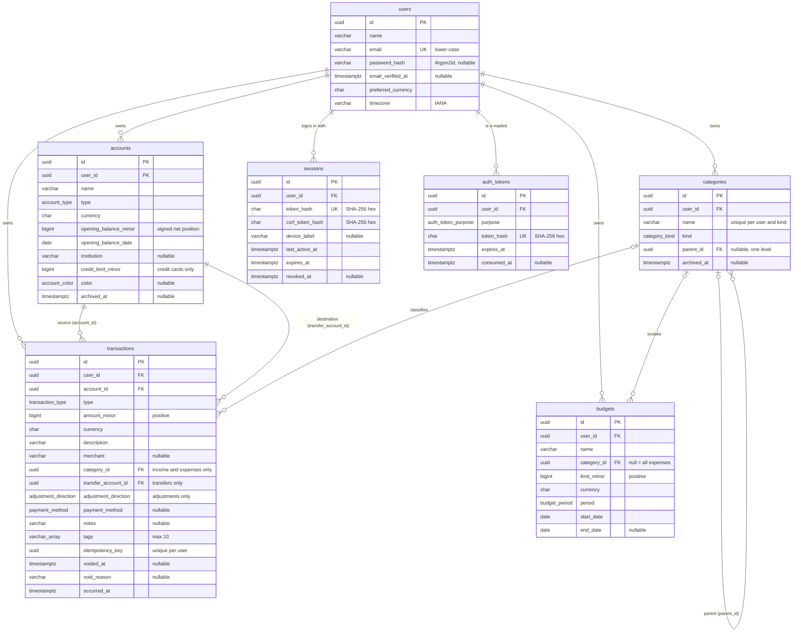

# CalmCash database design

PostgreSQL is the system of record. The schema is defined in
[`prisma/schema.prisma`](../prisma/schema.prisma); the authoritative DDL — including the CHECK
constraints Prisma cannot express — is in [`prisma/migrations/`](../prisma/migrations/).
This document covers the Phase 1 core models, the Phase 3 authentication models, the Phase 4
account-management rules (§3a), and the Phase 5 transaction ledger (§3b).

## 1. Entity relationships



Every table also has `created_at` and `updated_at` (`timestamptz(3)`).

| Model         | Purpose                                                                                         |
| ------------- | ----------------------------------------------------------------------------------------------- |
| `User`        | Owner of all data. Preferred currency and IANA time zone drive defaults and reporting.          |
| `Account`     | A place money lives (cash, bank, savings, wallet) or a debt (credit card); see §3a.             |
| `Category`    | Income or expense label, two levels deep; defaults provisioned per user (§3b).                  |
| `Transaction` | One income, expense, transfer, or balance adjustment (§3b).                                     |
| `Budget`      | A spending limit per period, for one category or all expenses.                                  |
| `Session`     | A browser session: hashed cookie token, hashed CSRF token, lifetime, revocation (Phase 3).      |
| `AuthToken`   | A single-use e-mailed token for e-mail verification or password reset, stored hashed (Phase 3). |

### Refinements to the initial contracts

These changes to the originally proposed fields are reflected in the database, the shared DTOs,
and the schemas:

- **`Category` model added** — `Transaction.categoryId` and `Budget.categoryId` reference it, so
  they are real foreign keys rather than free-form identifiers.
- **`Transaction.transferAccountId` added** — the destination of a transfer (see §3).
- **`TransactionDto` is a discriminated union** on `type`: transfers require `transferAccountId`
  and cannot have a `categoryId`; income and expense cannot have a destination.
- **Optional DTO fields are absent rather than `null`** — `merchant`, `notes`, `categoryId`, and
  `Budget.endDate` are omitted from JSON when the column is `NULL`.

## 2. Monetary representation

Money is the most sensitive data in the system, so it follows strict rules:

1. **Integer minor units in `BIGINT`.** Amounts are stored as the number of minor units (paise
   for INR, cents for USD) in `BIGINT` columns: `opening_balance_minor`, `amount_minor`, and
   `limit_minor`, `credit_limit_minor`. There are no `NUMERIC`, `REAL`, or `DOUBLE PRECISION` money columns.
2. **Never JavaScript `number`.** `BIGINT` exceeds `Number.MAX_SAFE_INTEGER` (2^53 − 1). Prisma
   returns `BigInt` columns as `bigint`, and code computes with `bigint` only. Floating-point
   arithmetic is never used for money: `0.1 + 0.2 !== 0.3`, but `10n + 20n === 30n`.
3. **Decimal strings in JSON.** DTOs carry amounts as canonical base-10 strings (`MinorUnitsString`,
   e.g. `"12550"` for ₹125.50), because JSON numbers are parsed as doubles. Helpers in
   `packages/shared/src/money/minor-units.ts` convert between the two:
   - `serializeMinorUnits(bigint) → string` — API responses.
   - `parseMinorUnits(string) → bigint` / `tryParseMinorUnits` — request input. These reject
     non-canonical input (`"007"`, `"1.5"`, `"+1"`, `"-0"`, …) and anything outside the BIGINT range.
   - `minorUnitsToDecimalString(bigint, currency)` — exact display/export strings (`"125.50"`)
     using string arithmetic, honouring each currency's ISO 4217 exponent (JPY 0, INR 2, KWD 3).
4. **Validated before persistence.** `minorUnitsSchema` and `positiveMinorUnitsSchema` validate
   the string form and range at the API edge; CHECK constraints enforce positivity in the database.
5. **Sign conventions:**

   | Column                  | Sign              | Meaning                                           |
   | ----------------------- | ----------------- | ------------------------------------------------- |
   | `opening_balance_minor` | signed            | Net position: negative = owed (cards, overdraft). |
   | `credit_limit_minor`    | strictly positive | Credit cards only.                                |
   | `amount_minor`          | strictly positive | Direction comes from `type`, never from the sign. |
   | `limit_minor`           | strictly positive | Spending ceiling for one period.                  |

6. **Currency on every monetary row.** `currency` is an ISO 4217 code (`CHAR(3)`, upper case,
   enforced by CHECK). The database accepts any well-formed code; the API accepts only codes in
   `CURRENCY_CODES` (`packages/shared/src/constants/currencies.ts`), so supporting a new currency
   needs no migration. Amounts in different currencies are never added together without an
   explicit conversion step (a later phase).
7. **Exact input.** People type major units ("12,500.50"); `parseDecimalAmount` in
   `packages/shared/src/money/decimal-input.ts` converts them to minor units with the currency's
   exponent and **rejects** extra decimal places instead of rounding (`10.005` INR, `10.5` JPY).
   Entered amounts are limited to ±999,999,999,999,999 minor units (`MAX_ENTERED_AMOUNT_MINOR`),
   so sums of many of them stay far inside `BIGINT`.

## 3. Transaction types and balance calculation

| `type`               | Effect on `account_id`                     | Effect on `transfer_account_id`       | Category                  | In income/expense reports |
| -------------------- | ------------------------------------------ | ------------------------------------- | ------------------------- | ------------------------- |
| `income`             | + `amount_minor`                           | must be `NULL`                        | required (API), `income`  | yes                       |
| `expense`            | − `amount_minor`                           | must be `NULL`                        | required (API), `expense` | yes                       |
| `transfer`           | − `amount_minor`                           | + `amount_minor` (required, ≠ source) | must be `NULL`            | no                        |
| `balance_adjustment` | ± `amount_minor` by `adjustment_direction` | must be `NULL`                        | must be `NULL`            | no                        |

A transfer is **one row**, not a pair of rows. Both sides of the movement are always present
together, and a transfer can never be counted twice or half-recorded. Voided rows (`voided_at` set)
count toward nothing. The balance of account `A` is:

```text
balance(A) = opening_balance_minor(A)
           + Σ amount_minor  where account_id = A           and type = 'income'
           − Σ amount_minor  where account_id = A           and type = 'expense'
           − Σ amount_minor  where account_id = A           and type = 'transfer'
           + Σ amount_minor  where transfer_account_id = A  and type = 'transfer'
           + Σ amount_minor  where account_id = A           and type = 'balance_adjustment' and direction = 'increase'
           − Σ amount_minor  where account_id = A           and type = 'balance_adjustment' and direction = 'decrease'
  (only rows with voided_at IS NULL)
```

Balances are always derived per account with this formula and with `bigint` (or SQL `BIGINT`/
`NUMERIC` aggregation) — never by summing all of a user's rows, and never across currencies.
Later phases extend the model without changing the rule:

- **Statement imports** will record each row's source and a deduplication fingerprint with a
  unique constraint (for example per account and external reference), so re-importing a statement
  cannot create duplicate transactions.
- **Cross-currency transfers** will add an explicit destination amount and currency instead of
  converting implicitly. Phase 5 rejects transfers between accounts of different currencies.

## 3a. Accounts and balance semantics (Phase 4)

### Account types

| `type`           | Classification | Created in the app | Balance may be negative    | Credit limit |
| ---------------- | -------------- | ------------------ | -------------------------- | ------------ |
| `cash`           | asset          | yes                | no                         | no           |
| `bank`           | asset          | yes                | yes (overdraft)            | no           |
| `savings`        | asset          | yes                | no                         | no           |
| `digital_wallet` | asset          | yes                | no                         | no           |
| `credit_card`    | liability      | yes                | yes (that is what is owed) | optional     |
| `other`          | asset          | yes                | yes                        | no           |
| `investment`     | asset          | no (Phase 1 value) | yes                        | no           |
| `loan`           | liability      | no (Phase 1 value) | yes                        | no           |

`CREATABLE_ACCOUNT_TYPES` and `ACCOUNT_TYPE_CLASSIFICATION` in
`packages/shared/src/constants/accounts.ts` are the single source of these rules. `investment` and
`loan` stay in the enum for compatibility; tracking them belongs to later phases. Only the bank or
provider _name_ is stored (`institution`) — never account numbers, card numbers, or credentials.

### One sign convention: the net position

Every balance — opening or current, for every type — is a **signed net position** in minor units:
positive means money held (or a card in credit), negative means money owed.

| Example                                   | `opening_balance_minor` | Shown as                                      |
| ----------------------------------------- | ----------------------- | --------------------------------------------- |
| Savings account with ₹12,500.50           | `1250050`               | Balance ₹12,500.50                            |
| Bank account overdrawn by ₹2,000          | `-200000`               | Overdrawn ₹2,000.00                           |
| Credit card owing ₹12,500 (limit ₹1 lakh) | `-1250000`              | Amount owed ₹12,500.00 · ₹87,500.00 available |

With one convention, one formula serves every account, and a transfer is always money leaving one
balance and entering another. `classification` (in every `AccountDto`) tells clients how to present
it: liabilities report `amountOwedMinor` (the negated position) and, for credit cards with a limit,
`availableCreditMinor = limit − owed` (negative when over the limit). The web form asks credit cards
for the _amount owed_ as a positive number and stores its negation.

**Never one ambiguous total.** Totals are per currency and keep assets (`assetsMinor`, money held;
an overdraft reduces it) and liabilities (`liabilitiesMinor`, money owed; a card in credit reduces
it) side by side. They are never netted into a "balance", and currencies are never added together.

### Opening balance and current balance

- `opening_balance_minor` is the net position **at the start of** `opening_balance_date`, a calendar
  date interpreted in the owner's time zone (`users.timezone`). It is required when an account is
  created, so zero is always deliberate; the date defaults to today and cannot be in the future.
- **Current balance** = opening balance + the signed effect of every _counted_ transaction:

  ```text
  current(A) = opening_balance_minor(A)
             + Σ income              on A
             − Σ expense             on A
             − Σ transfer            where A is the source        (account_id = A)
             + Σ transfer            where A is the destination   (transfer_account_id = A)
             + Σ adjustment ↑        on A   (balance_adjustment, direction increase)
             − Σ adjustment ↓        on A   (balance_adjustment, direction decrease)
  ```

  A transaction counts when it belongs to the account's owner, has the account's currency, is not
  voided, and its `occurred_at` is on or after the start of the opening date in the owner's time
  zone. Earlier rows are history from before tracking began (the Phase 5 API refuses to record
  them). Transfers only move money and adjustments only correct a balance; neither ever counts as
  income or spending. Archived accounts keep computing their balance from their history.

- The arithmetic lives only in `apps/api/src/modules/accounts/account-balance.ts` (pure, tested).
  `account-ledger.ts` (`queryMovementTotals`) supplies per-account sums in **one aggregate query**
  for the user, optionally up to an instant (`asOf`, used by reconciliation), and works inside a
  write's database transaction (`SUM` over `BIGINT` yields `NUMERIC`, returned as text and parsed to
  `bigint`, so no step can overflow or round). Nothing else calculates balances: controllers and the
  web app only display them. If the owner later changes their time zone, the start of the opening
  date moves with it.

### Opening-balance corrections

Until any transaction uses the account (as source or destination), the opening balance, its date,
and the currency can be corrected freely; a currency change must restate the opening balance and
credit limit in the new currency. **Once a transaction exists, those three fields are locked**
(`409 CONFLICT`), because changing them would silently change which transactions count and what
the history means; a voided transaction keeps them locked too, because it can be restored. To
correct a balance once history exists, record a **balance adjustment** (§3b); the opening balance is
never overwritten. Edits run in a database transaction that first locks the account row
(`lockAccounts`, `SELECT … FOR UPDATE`), the same lock every transaction write takes, so the "has
transactions" decision cannot go stale. Other details (name, provider, colour, and type within the
same classification) stay editable — except that an account whose _current_ balance is below zero
cannot become a type that must never be negative (cash, savings, wallet), a gap closed in Phase 5
now that transactions can move the balance.

### Archiving

`archived_at` marks an account as archived: it leaves the default list and the summary, cannot be
edited until restored, cannot receive new transactions, and its existing transactions are
read-only (no edit, void, or restore) until the account is restored. Nothing reactivates an account
implicitly. Nothing is deleted —
transactions, opening balance, and balance stay intact, and restoring returns the account as it was.
Archive and restore are idempotent (repeating them changes nothing and returns the same state).
There is no hard delete: `transactions.account_id` uses `NO ACTION`, so an account with history can
never be removed while its user exists.

### Names are not unique

Phase 1 had a unique `(user_id, name)` constraint. Phase 4 removes it: two accounts may legitimately
share a name ("Cash" at home and in a wallet, two banks' "Credit card"), and an archived account's
name must be reusable. The UI tells accounts apart by type, provider, and currency. The index
`(user_id, archived_at)` replaces it for "accounts of a user" lookups by status.

## 3b. Transactions, categories, and tags (Phase 5)

### What a transaction records

| Field                      | Meaning                                                                                                          |
| -------------------------- | ---------------------------------------------------------------------------------------------------------------- |
| `description`              | What it was for. For adjustments: the reason (required). Transfers default to "Transfer between accounts".       |
| `merchant`                 | Counterparty: merchant or recipient of an expense, payer of income. Never on transfers/adjustments.              |
| `category_id`              | Required by the API for income and expenses (a category of the matching kind); null otherwise.                   |
| `payment_method`           | Optional on income, expenses, and transfers; never on adjustments.                                               |
| `adjustment_direction`     | `increase` or `decrease` of the signed net position; adjustments only.                                           |
| `tags`                     | Up to 10 normalised labels (`varchar(32)[]`).                                                                    |
| `notes`                    | Optional free text (line breaks allowed).                                                                        |
| `currency`                 | Always the account's currency (set by the API, never by the client).                                             |
| `occurred_at`              | UTC instant; not on a future calendar day and not before any involved account's opening date (user's time zone). |
| `idempotency_key`          | Client key of the request that created the row (see below); never exposed.                                       |
| `voided_at`, `void_reason` | Soft deletion (see below).                                                                                       |

The request contracts are discriminated on `type` (`createTransactionInputSchema`): a field another
type uses is **rejected**, not ignored. A partial update (`PATCH`) is merged with the stored row and
the result must be a complete, valid transaction of its (possibly new) type, so changing an expense
into a transfer requires `merchant: null` and `categoryId: null`.

### Balance adjustments (reconciliation)

When the balance a bank, cash count, or statement shows differs from CalmCash's, the person enters
the observed balance (for a card: the amount owed, which the client negates into the signed net
position). The API compares it with the account's balance **at the same instant**
(`queryMovementTotals(…, { asOf })`), and `adjustmentBetween` returns `{ direction, amountMinor }`
with a positive amount. Recording it requires the signed change the person confirmed
(`expectedAdjustmentMinor`); if the balance moved since the preview, nothing is recorded (409). The
opening balance and history never change. For a liability, `decrease` means _more owed_.

### Voiding

`DELETE` does not exist for transactions. Voiding sets `voided_at` (and an optional reason); the
row, its accounts, category, and tags stay, but it counts toward no balance, list (by default), or
total. Restoring clears `voided_at`. Both are idempotent: repeating them changes nothing, so an
effect can never be reversed twice. A transfer is one row, so it is always voided whole. Voiding and
restoring run the same locks and balance checks as any write (voiding income that cash was spent
from would take the cash negative and is refused).

### Idempotency

`POST /transactions` and `POST /transactions/reconciliations` accept an `Idempotency-Key` header (a
UUID). The key is stored with the row under a unique `(user_id, idempotency_key)` index. A retry
with the same key returns the original transaction (`200`) instead of recording it again; a key
reused for a different movement is refused (`409`). Concurrent retries serialise on the account lock
and see the first row; if two still race, the unique index decides and the loser returns the winner.
The web client keeps one key per open form, so a retry after a lost response can never duplicate.

### Categories

Categories form a two-level tree (`parent_id`; one level, same user and kind — API-enforced).
Every user gets a default set on first use (`GET /categories` or `POST /categories` call
`ensureDefaults`), created with `INSERT … ON CONFLICT DO NOTHING` against the existing unique
`(user_id, kind, name)`, so concurrent first requests never duplicate anything and later requests
create nothing. Names are therefore unique per user and kind across the tree (subcategories use
specific names). Only the name can change; kind and position are fixed so history is never moved
between income and spending. Archiving (`archived_at`, cascades to subcategories) hides a category
from new transactions while past transactions and budgets keep it; nothing is ever deleted, so the
`SET NULL` and `NO ACTION` rules below are never triggered by the API.

### Tags

Tags live on the transaction (`varchar(32)[]`, GIN-indexed): a user's tags are exactly the tags on
their own transactions, so ownership needs no extra table. They are normalised the same way in the
web app and the API (`normalizeTag`: trimmed, lower case, spaces become hyphens; letters, marks,
digits, `-`, `_`), de-duplicated, and at most 10 per transaction. Filters match transactions that
carry **all** of the requested tags.

### Locking and concurrency

Every write that can change a balance runs in one database transaction (`TransactionsRepository.inLedger`):

1. lock the transaction row(s) being changed (`SELECT … FOR UPDATE`, ID order);
2. lock every account the old and new versions touch (`lockAccounts`: `… ORDER BY id FOR UPDATE`),
   reading each account's counting start with the same SQL the balance query uses;
3. check ownership, archived state, currency, dates, and category against the locked rows;
4. read the balances, write, read them again (all through `queryMovementTotals` in the same
   transaction), and refuse the write if a cash, savings, or wallet account would end below zero and
   lower than before (`breaksNonNegativeRule`);
5. commit — or roll everything back on any error, so no account ever sees half a transfer.

Locks are always taken in the same global order (transaction rows, then accounts, each by ID), so
concurrent writes queue instead of deadlocking. Account edits from Phase 4 take the same account
lock. Category and tag bulk changes lock the transaction rows (and the accounts, to enforce the
archived rule). Integration tests fire parallel requests on separate connections to prove that
simultaneous spending cannot overdraw cash and that crossing transfers neither deadlock nor lose
money; removing the lock makes the first of those tests fail.

## 4. Integrity rules

### Constraints

| Table          | Constraint                                                             | Rule                                                                           |
| -------------- | ---------------------------------------------------------------------- | ------------------------------------------------------------------------------ |
| `users`        | `users_email_key` (unique)                                             | One account per e-mail address.                                                |
| `users`        | `users_email_lowercase_check`                                          | E-mail stored lower-case, so uniqueness is case-insensitive.                   |
| `users`        | `users_password_hash_format_check`                                     | A stored password is always an Argon2id PHC string.                            |
| `sessions`     | `sessions_token_hash_key` (unique)                                     | One session per token hash.                                                    |
| `sessions`     | `sessions_*_hash_format_check`                                         | Token and CSRF hashes are 64 lower-case hex characters.                        |
| `sessions`     | `sessions_expiry_after_creation_check`                                 | `expires_at > created_at`.                                                     |
| `auth_tokens`  | `auth_tokens_token_hash_key` (unique)                                  | One token per hash; looked up by hash on consumption.                          |
| `auth_tokens`  | `auth_tokens_token_hash_format_check`, `…_expiry_after_creation_check` | Hex digest; coherent lifetime.                                                 |
| `accounts`     | `accounts_credit_limit_check`                                          | `credit_limit_minor` is null, or positive on a `credit_card`.                  |
| `accounts`     | `accounts_institution_not_blank_check`                                 | A provider name, if present, is not blank.                                     |
| `accounts`     | `accounts_opening_balance_date_check`                                  | `opening_balance_date >= 1900-01-01`.                                          |
| `accounts`     | `accounts_archived_after_creation_check`                               | `archived_at` is null or not before `created_at`.                              |
| `categories`   | `categories_user_id_kind_name_key` (unique)                            | Category names are unique per user and kind.                                   |
| `transactions` | `transactions_amount_minor_positive_check`                             | `amount_minor > 0`.                                                            |
| `transactions` | `transactions_transfer_shape_check`                                    | Transfers: destination present, ≠ source, no category. Others: no destination. |
| `transactions` | `transactions_adjustment_shape_check`                                  | Direction iff adjustment; adjustments have no category, merchant, or method.   |
| `transactions` | `transactions_tags_check`                                              | At most 10 tags, none null.                                                    |
| `transactions` | `transactions_void_check`, `…_void_reason_not_blank_check`             | A reason only on voided rows; never voided before it was created.              |
| `transactions` | `transactions_user_id_idempotency_key_key` (unique)                    | One transaction per user and idempotency key.                                  |
| `categories`   | `categories_parent_not_self_check`, `…_archived_after_creation_check`  | No self-parent; archived not before created.                                   |
| `budgets`      | `budgets_limit_minor_positive_check`                                   | `limit_minor > 0`.                                                             |
| `budgets`      | `budgets_date_range_check`                                             | `end_date` is null or ≥ `start_date`.                                          |
| `budgets`      | `budgets_custom_period_end_date_check`                                 | `custom` periods require an `end_date`.                                        |
| all            | `*_currency_format_check`                                              | `currency ~ '^[A-Z]{3}$'`.                                                     |
| all            | `*_name_not_blank_check` / `*_description_not_blank_check`             | Text identifiers cannot be blank.                                              |

Type-dependent balance rules (no negative cash, savings, or wallet balances) are enforced by the
shared `accountRuleViolations` on every account create and update, and on every transaction write
under the account lock (§3b), rather than by a CHECK constraint: a balance is an aggregate over many
rows, which a CHECK cannot see.

Rules enforced by the service rather than the database (documented limitations): a subcategory's
parent has the same user and kind and is top-level; a transaction's accounts and category belong to
its user and match its currency/kind; transfers carry no merchant (a constraint on that existing
column could reject legacy rows, so it was left to the API).

These rules are also validated earlier, at the API edge with Zod. The database copy is the last
line of defence against a buggy code path or a manual query.

### Foreign keys and deletion behaviour

| Reference                                     | On delete   | Why                                                                      |
| --------------------------------------------- | ----------- | ------------------------------------------------------------------------ |
| `*.user_id → users`                           | `CASCADE`   | Deleting a user removes all of their data.                               |
| `transactions.account_id → accounts`          | `NO ACTION` | An account with history cannot be deleted directly (archive it instead). |
| `transactions.transfer_account_id → accounts` | `NO ACTION` | Same as above for transfer destinations.                                 |
| `transactions.category_id → categories`       | `SET NULL`  | Deleting a category un-categorises its transactions; amounts are kept.   |
| `categories.parent_id → categories`           | `NO ACTION` | A category with subcategories cannot be deleted from under them.         |
| `budgets.category_id → categories`            | `NO ACTION` | Prevents silently widening a budget to "all categories".                 |

`NO ACTION` is used instead of `RESTRICT` on purpose. The check runs at the end of the statement,
so deleting a user, which cascades to both transactions and accounts, still succeeds, while
deleting a single account that has transactions is rejected.

### Ownership

Every user-owned row carries `user_id`. Services must scope every query by the authenticated user,
and must verify that referenced rows (account, category, transfer destination) belong to the same
user and use the same currency before writing. Composite foreign keys can harden this at the
database level later if needed.

## 5. Keys, time, and indexes

- **Primary keys:** UUIDv7 (`@default(uuid(7))`, PostgreSQL `uuid`). They are time-ordered, so
  B-tree inserts stay local, and they are safe to expose in URLs.
- **Instants:** `timestamptz(3)`, stored in UTC and serialised as ISO 8601 with `Z`
  (`IsoDateTimeString`).
- **Calendar dates:** budget windows use `date` (`IsoDateString`, `YYYY-MM-DD`), interpreted in the
  user's `timezone`.
- **Indexes:**

  | Index                                               | Serves                                               |
  | --------------------------------------------------- | ---------------------------------------------------- |
  | `transactions (user_id, occurred_at DESC)`          | A user's timeline, newest first; date-range reports. |
  | `transactions (account_id, occurred_at DESC)`       | An account ledger; balance calculation.              |
  | `transactions (transfer_account_id)`                | Incoming transfers for an account's balance.         |
  | `transactions (category_id)`                        | Category reports and `ON DELETE SET NULL`.           |
  | `budgets (user_id)`, `budgets (category_id)`        | A user's budgets; FK checks.                         |
  | `sessions (user_id)`                                | A user's sessions (list, revoke others).             |
  | `sessions (expires_at)`, `auth_tokens (expires_at)` | Cleanup of ended records.                            |
  | `auth_tokens (user_id, purpose)`                    | Replacing a user's outstanding tokens.               |
  | `accounts (user_id, archived_at)`                   | A user's accounts, filtered by status (Phase 4).     |
  | `transactions USING GIN (tags)`                     | Tag filters and search (Phase 5).                    |
  | unique `transactions (user_id, idempotency_key)`    | Retried creates find their first row (Phase 5).      |
  | `categories (parent_id)`                            | Subcategories; category filters include children.    |

  Search (`q`) uses case-insensitive `LIKE` on description, merchant, notes, and category names,
  scoped by `user_id` (a personal ledger is small); wildcards in the search text are escaped. A
  trigram index is the next step if histories grow large.
  | unique `categories (user_id, kind, name)` | Also serves "categories of a user". |

## 6. Database models vs. API DTOs

Prisma models are internal to the API. Responses always go through a mapper into a shared DTO:

| Database (Prisma)                         | API DTO (`@calmcash/shared`)                  |
| ----------------------------------------- | --------------------------------------------- |
| `bigint` money columns                    | `MinorUnitsString` (`serializeMinorUnits`)    |
| `Date` (`timestamptz`)                    | `IsoDateTimeString` (`toISOString()`)         |
| `Date` (`date`)                           | `IsoDateString` (`YYYY-MM-DD`)                |
| `null` optional column                    | Property omitted                              |
| Enum values                               | Identical literals (asserted by a test)       |
| `password_hash`, session and token hashes | Never present                                 |
| `email_verified_at`                       | `emailVerifiedAt` (absent while unverified)   |
| `voided_at`                               | `status` (`active`/`voided`) + `voidedAt`     |
| `archived_at` (categories)                | `status` (`active`/`archived`) + `archivedAt` |
| `idempotency_key`                         | Never present                                 |

`apps/api/src/lib/domain-enums.test.ts` asserts that the generated Prisma enums and the shared
literal unions are identical, both at runtime and at the type level.

## 7. Migration workflow

- **Change the schema:** edit `prisma/schema.prisma`, then run
  `pnpm db:migrate --name <change_name>`. This creates and applies a migration.
- **Add custom SQL** (CHECK constraints, partial indexes, data backfills):
  `pnpm exec prisma migrate dev --create-only --name <change_name>`, edit the generated
  `migration.sql`, then `pnpm db:migrate`.
- **Never edit an applied migration.** Add a new migration instead.
- **Production:** `pnpm db:deploy` (`prisma migrate deploy`) applies pending migrations without
  prompting and never resets data.
- **Phase 3 migration** (`20261026041933_add_authentication`) is purely additive: two nullable
  `users` columns, the `sessions` and `auth_tokens` tables, and CHECK constraints. Existing users and
  financial data are untouched; a user without a password sets one through password reset.
- **Phase 4 migration** (`*_account_management`) adds the `savings` type, the `account_color` enum,
  `opening_balance_date` (backfilled from each account's creation day in its owner's time zone, then
  `NOT NULL`), `institution`, `credit_limit_minor`, `color`, and `archived_at` with CHECK
  constraints, and replaces the unique name index with `(user_id, archived_at)`. No existing value
  changes apart from the backfill.
- **Phase 5 migrations** are two, because PostgreSQL cannot use an enum value in the transaction
  that added it: `*_transaction_type_balance_adjustment` adds the `balance_adjustment` value only;
  `*_transaction_management` adds the `adjustment_direction` and `payment_method` enums, the new
  transaction columns (`tags` defaults to an empty array, everything else nullable, so existing rows
  stay active, untagged, and valid), category `parent_id`/`archived_at`, the indexes above, and the
  CHECK constraints (which only concern new columns or the new type, so no existing row can fail).
  They were applied with `prisma migrate deploy`; no data was reset.
- **Check for drift:**
  `pnpm exec prisma migrate diff --from-config-datasource --to-schema prisma/schema.prisma --exit-code`
  exits with 0 when the database matches the schema.
