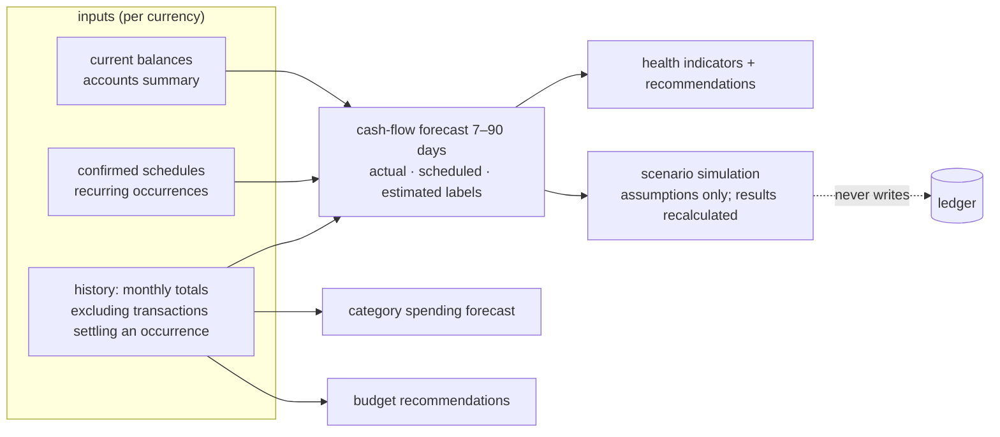

# AI and financial intelligence

Both features are **read-only over the ledger** and deterministic where it matters: every figure
comes from CalmCash's own services; a local model may choose tools and phrase answers, never
produce numbers or identifiers ([ADR 0004](adr/0004-local-first-ollama.md)). Details:
[../architecture.md §19–20](../architecture.md#19-ai-assistant-and-insights-phase-10).

## 11. Assistant tool orchestration

```mermaid
sequenceDiagram
  autonumber
  participant B as Browser
  participant A as AiService
  participant M as Ollama (private network)
  participant T as Allowlisted read-only tools
  B->>A: question (session, CSRF, per-user shared rate limit)
  A->>A: AI on for server and person? prompt size bounded
  A->>M: system prompt + question + tool list (data in delimited, untrusted blocks)
  M-->>A: tool call(s) by name with JSON arguments
  A->>A: validate arguments with Zod; unknown tool → refused
  A->>T: run tool for the session's user only (dashboard, transactions, budgets, …)
  T-->>A: figures + identifiers from the services
  A->>M: tool results → wording only
  M-->>A: narrative
  A-->>B: blocks built from tool results (figures never parsed from model text)
```

Prompt injection in transaction notes, merchants, or statement rows is treated as data: tools are
read-only, arguments are validated, the owner always comes from the session, and drafts or
suggestions are applied only when the person submits the ordinary form. With `AI_ENABLED=false`
(required on Vercel) AI controls explain that AI is off; insights, reports, suggestions from
history, forecasts, and scenarios keep working.

## 12. Forecasting and scenarios



Scenarios store only assumptions (`financial_scenarios.assumptions` JSON, validated); results are
recalculated on every run and never written to the ledger. Linking ordinary payments to scheduled
occurrences (Phase 12) keeps the "scheduled" and "everyday spending" inputs from double counting.
