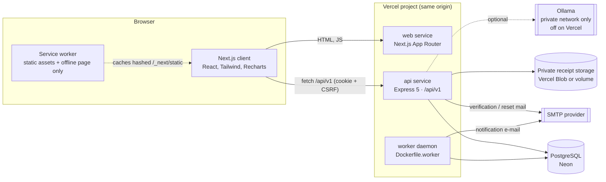
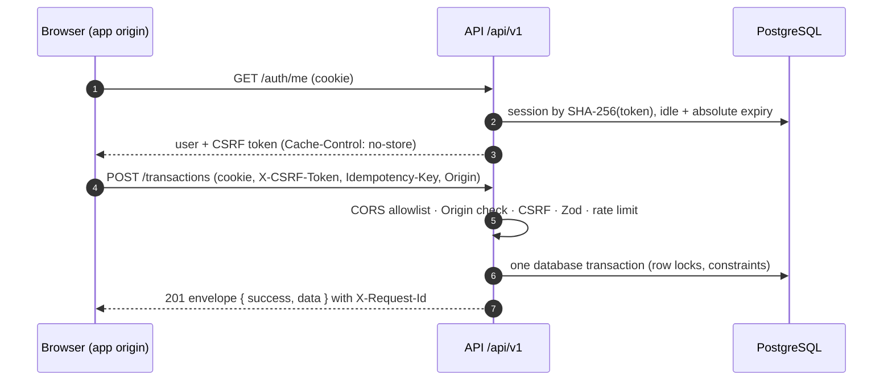
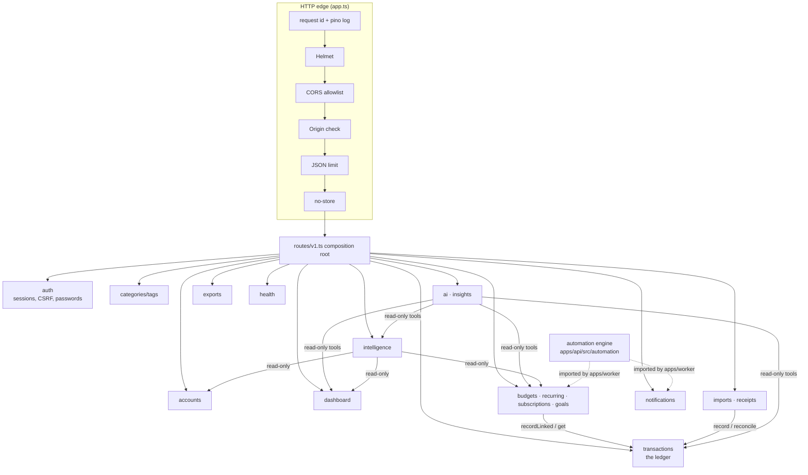

# System architecture

CalmCash is a **modular monolith** ([ADR 0001](adr/0001-modular-monolith.md)): one Express API
holding all financial rules, one Next.js web client, and one background worker that reuses the
API's domain code. PostgreSQL is the only stateful dependency besides private receipt storage.
Detailed module documentation stays in [../architecture.md](../architecture.md); this page is
the map.

## 1. Components



| Component | Runs as                                         | State                                            | Talks to                                             |
| --------- | ----------------------------------------------- | ------------------------------------------------ | ---------------------------------------------------- |
| web       | Next.js (static + client rendered)              | none                                             | nothing server-side; browser calls the API           |
| api       | Express on Vercel Functions or `Dockerfile.api` | none (sessions, rate limits, jobs in PostgreSQL) | PostgreSQL, receipt storage, SMTP, Ollama (optional) |
| worker    | long-running Node process (`Dockerfile.worker`) | none (jobs in PostgreSQL)                        | PostgreSQL, SMTP                                     |
| shared    | TypeScript package bundled into all three       | —                                                | —                                                    |

No component calls another over HTTP except the browser → API. The worker imports the API's
automation module at build time; it never calls the API.

## 2. Browser ↔ API



- Every response is JSON `{ success, data }` or `{ success: false, error: { code, message,
details?, requestId } }`; the web client validates both with the shared Zod schemas.
- On Vercel the browser uses relative `/api/v1` URLs (same origin). Standalone, it uses
  `NEXT_PUBLIC_API_URL` (`localhost:3000` → `localhost:4000`, same site).
- Nothing authenticated is cacheable: `Cache-Control: no-store` on every API response (set per
  router and again app-wide), and the service worker never handles `/api/*`.

## 3. API module boundaries



Rules: modules never import each other's routes; money only moves through the transactions
service (its `recordLinked` lets planning and imports write atomically with their own rows); the
AI layer has read-only tools; the worker's ledger stub refuses every write.

## 4. Authentication and session

```mermaid
sequenceDiagram
  autonumber
  participant B as Browser
  participant A as API
  participant D as PostgreSQL
  B->>A: POST /auth/login {email, password} (Origin)
  A->>D: shared rate-limit counters (per IP, per e-mail; failures only)
  A->>D: user by e-mail
  A->>A: Argon2id verify (dummy hash when unknown → same timing)
  A->>D: INSERT session (SHA-256 token hash, CSRF hash, expiry)
  A-->>B: Set-Cookie __Host-calmcash_session; HttpOnly; Secure; SameSite=Strict; Path=/
  Note over B,A: later requests
  B->>A: request with cookie (+ X-CSRF-Token on unsafe methods)
  A->>D: session lookup; touch lastActiveAt at most periodically
  A-->>B: 401 UNAUTHORIZED when expired, idle, or revoked
```

Password change or reset revokes other sessions; reset tokens are single-use, hashed, and
short-lived. Details: [../authentication.md](../authentication.md) and
[security.md](security.md).
