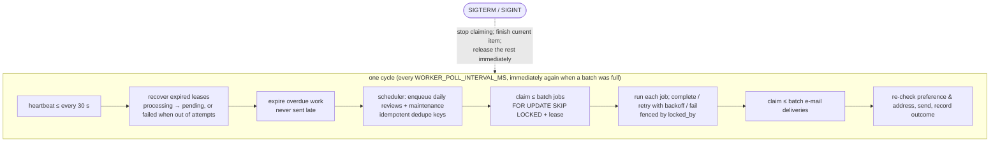
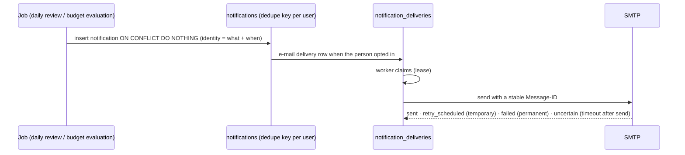

# Background worker and notifications

`apps/worker` is a separate long-running process ([ADR 0002](adr/0002-postgresql-job-queue.md)).
The engine lives in `apps/api/src/automation` and reuses the domain services; the worker never
records transactions or changes balances (its ledger stub refuses every write). Detailed rules:
[../architecture.md §18](../architecture.md#18-notifications-and-automation-phase-9).

## 9. Job processing



Business events (a transaction written, a budget changed) are rows written **in the same
database transaction** as the change, so the worker never misses or invents one.

## 10. Notification delivery



In-app notifications never depend on e-mail. A stopped worker means no new reminders and no
e-mail — nothing is lost (work waits in PostgreSQL, within each job's expiry), and the app never
claims mail was sent: Settings shows whether the worker is running from its heartbeat.

## Shutdown (verified with real signals on Linux)

1. SIGTERM/SIGINT → `stop()`: no new batch is claimed.
2. The job or e-mail in progress finishes.
3. Claimed but unstarted items are **released** at once (status back to pending, the claim's
   attempt returned, lease cleared) — another worker picks them up without waiting for the lease.
4. Health server closed, SMTP pool closed, `prisma.$disconnect()`.
5. Exit 0; forced exit 1 after `SHUTDOWN_TIMEOUT_MS` (leases then expire and are recovered).

Container test (Docker Desktop Linux VM, `calmcash-worker` image, 200 queued jobs, batch 50):
SIGTERM → exit 0 in 4.4 s with 43 jobs released; SIGINT → exit 0 in 0.4 s with 29 released;
in both runs **0 rows left `processing`** and **0 released rows with a used attempt**. API image:
SIGTERM and SIGINT → exit 0 in under 0.7 s, "Shutdown complete" logged.

Set the platform's stop grace period longer than `SHUTDOWN_TIMEOUT_MS`.

## Monitoring

| Signal           | Where                                                               | Healthy                                   | Act when                                                     |
| ---------------- | ------------------------------------------------------------------- | ----------------------------------------- | ------------------------------------------------------------ |
| Heartbeat age    | `worker_heartbeats.last_seen_at`; `/health/status` → `worker`       | ≤ 60 s (written every 30 s while working) | > 5 min (`stale`) — see runbook "Worker outage"              |
| Process health   | worker `GET /health` (port 8080 in the image)                       | 200 `ok`                                  | 503 `stalled`: no completed cycle within max(5 polls, lease) |
| Due jobs waiting | `/health/status` → `jobs.oldestDueSecondsAgo`; `pnpm worker:status` | < 2 × poll interval                       | growing for > 15 min                                         |
| Failed jobs      | `jobs.failed`, `pnpm worker:status`                                 | 0 new                                     | any new — inspect `last_error_code`                          |
| E-mail failures  | `emailDeliveries.failed`, `retryScheduled`                          | 0 / small                                 | sustained growth → runbook "E-mail delivery"                 |

Inspect and recover:

```sh
pnpm worker:status                        # counts by status, recent workers (no user data)
pnpm --filter @calmcash/worker requeue-failed            # all failed jobs that have not expired
pnpm --filter @calmcash/worker requeue-failed <job-id>…  # specific jobs
```

Deploy worker updates by starting the new version and then stopping the old one (both can run;
`SKIP LOCKED` and leases prevent double processing). A job written by a newer version that an
older worker cannot read fails alone with `unknown_kind` and can be re-queued after the rollout.
