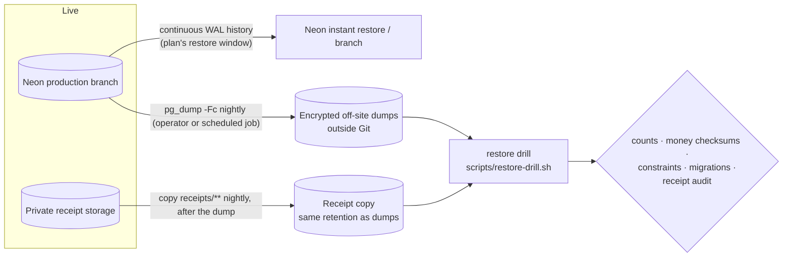

# Backup and disaster recovery

A CalmCash backup has **two parts that must match**: the PostgreSQL database and the private
receipt files it references. Restoring only the database is not a complete recovery.

## 14. What is backed up, and how



| Layer                     | Mechanism                                                                        | Frequency                      | Retention                                                                | Location / encryption                                                                  |
| ------------------------- | -------------------------------------------------------------------------------- | ------------------------------ | ------------------------------------------------------------------------ | -------------------------------------------------------------------------------------- |
| Point-in-time (primary)   | Neon history window: restore a branch to any moment, or branch from a past point | continuous                     | **Free: 6 h** (≤ 1 GB-month); Launch: up to 7 days; Scale: up to 30 days | Neon (provider-managed, encrypted at rest)                                             |
| Logical dumps (secondary) | `pg_dump --format=custom` of the production database                             | daily + before every migration | operator policy, e.g. 7 daily + 4 weekly                                 | storage outside Neon and outside Git; encrypted (e.g. `age`/`gpg` or encrypted bucket) |
| Receipt files             | copy of `receipts/` (Blob) or the receipt volume                                 | daily, **after** the dump      | same as dumps                                                            | private, encrypted, never public URLs                                                  |

On the Free plan the 6-hour window only covers mistakes noticed the same day; daily logical dumps
are what make longer recovery possible. Neon's manual snapshots (1 on Free) are useful before a
risky migration. The drill script refuses anything but a `*_restore_drill` target database and
never writes to the source.

**Consistency.** Receipt rows are written after their file and deleted before their file. Taking
the dump first and copying files second means every receipt row in the dump has its file in the
copy (files deleted in between are the only gap and are reported as "missing"); files without a
row are orphans and are removed by the audit after the 24 h grace period.

## Recovery objectives (targets, not guarantees)

| Scenario                                            | RPO (data that may be lost)                                       | RTO (time to recover) |
| --------------------------------------------------- | ----------------------------------------------------------------- | --------------------- |
| Bad deploy / mistaken data change, noticed < window | ~0 (Neon point-in-time)                                           | < 30 min              |
| Same, noticed after the window                      | since the last daily dump (≤ 24 h)                                | 1–2 h                 |
| Lost receipt storage                                | since the last file copy (≤ 24 h)                                 | 1–2 h                 |
| Neon region outage                                  | none if Neon recovers; else ≤ 24 h from dumps into a new provider | hours                 |

**Writes during restoration.** Put the app in maintenance first: stop the worker daemon, and
block writes (e.g. temporarily point the API at a read-only role or take the API service down).
Restore into a **new** Neon branch, verify it with the drill checks, then switch `DATABASE_URL` /
`DIRECT_URL` to the restored branch and redeploy. Never restore over the only copy of production;
keep the old branch until the restored one is verified. Anything written after the restore point
is lost unless it can be replayed (e.g. from a newer dump).

## Restore drill

`scripts/restore-drill.sh` performs the whole check against an isolated database:

1. `pg_dump -Fc` of the source (synthetic or a production copy; never writes to it).
2. Drop/create the `*_restore_drill` database; `pg_restore --exit-on-error`.
3. `prisma migrate status` on the restored database — must be up to date.
4. Source vs restore: row counts and exact money checksums (accounts' opening balances,
   transactions per currency plus an ordered md5 of every `id/amount/voided` triple, budget
   limits, schedules, goals, contributions, receipt bytes, notifications, scenarios, imports,
   AI messages).
5. Every constraint (PK, FK, CHECK, NOT NULL) restored and validated.
6. Optional: receipt audit of the restored metadata against a restored copy of the files.

Result of the Phase 12 drill (2026-11-05, local Docker PostgreSQL 18, synthetic dataset of 20
users / 58 800 transactions / 5 receipts):

| Check               | Result                                                       |
| ------------------- | ------------------------------------------------------------ |
| Dump / restore time | 2.2 MB dump in < 1 s; restore in 1–2 s                       |
| Migrations          | up to date (11 migrations)                                   |
| Counts and money    | all 14 checks match, including `INR:18659571916` and the md5 |
| Constraints         | 105 CHECK, 41 FK, 27 PK, 219 NOT NULL — 0 not validated      |
| Receipts            | 5 stored, 5 referenced, 0 missing, 0 orphans                 |

Run it quarterly and after any change to the backup tooling:

```sh
SOURCE_DATABASE_URL=… DRILL_DATABASE_URL=…/calmcash_restore_drill \
RECEIPTS_DIR=/restored/receipts bash scripts/restore-drill.sh
```

Limitations: the drill has not been run against Neon itself (no Neon project was touched in this
phase); Neon's point-in-time restore must be rehearsed in the Neon console on a non-production
branch. Blob receipts need a copy tool (e.g. a script using `@vercel/blob` `list`/`get`) — the
audit command works against Blob directly, but no automated Blob copy job ships in this repo.

## Missing and orphaned receipt files

```sh
pnpm --filter @calmcash/api receipts:audit                    # report only
pnpm --filter @calmcash/api receipts:audit --delete-orphans   # remove orphans older than 24 h
```

Exit code 3 means missing files or failed deletions. Missing files are listed by receipt ID only;
the receipt stays visible and answers "file missing" when opened. Restore the file from the copy
(same key path) or, if it is unrecoverable, delete that receipt through the app.
