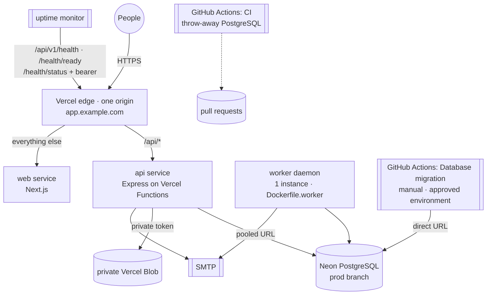

# Deployment architecture

The repository's chosen target is **Vercel** (`vercel.json`: Services + a worker Daemon) with
**Neon** PostgreSQL, **private Vercel Blob** for receipts, and an external SMTP provider. The same
code also runs as containers (`Dockerfile.api`, `Dockerfile.worker`) on any host; nothing in the
business logic depends on a provider. Step-by-step setup: [../vercel-deployment.md](../vercel-deployment.md);
operations: [runbooks.md](runbooks.md).

## 13. Topology

| Environment | Web + API                                 | Database                                  | Receipts                    | Worker                                    |
| ----------- | ----------------------------------------- | ----------------------------------------- | --------------------------- | ----------------------------------------- |
| Local       | `pnpm dev` (`:3000` + `:4000`, same site) | Docker `calmcash` / `calmcash_test`       | `.data/receipts` (ignored)  | `pnpm dev:worker`, Mailpit                |
| CI          | built, not served                         | service container `calmcash_ci` / `_test` | in-memory in tests          | integration tests run its engine          |
| Preview     | Vercel preview deployment (same origin)   | separate Neon branch                      | separate private Blob store | **none** (daemons run in production only) |
| Production  | Vercel production, custom domain          | Neon production branch                    | private Blob store          | daemon, 1 instance                        |

## Origins, cookies, and CORS

**Production (recommended, as configured): one origin.** `https://app.example.com` serves the
web app and `/api/*`. The session cookie is `__Host-calmcash_session` — `Secure`, `HttpOnly`,
`SameSite=Strict`, `Path=/`, no `Domain` (host-only). `CORS_ORIGINS` and `WEB_APP_URL` are that
origin. CORS is then barely exercised, but stays an explicit allowlist with credentials; CSRF
tokens and the `Origin` check stay on.

**Alternative: separate hosts on one site** (`app.example.com` + `api.example.com`, e.g. the API as
a container). Same-site, cross-origin: `SameSite=Strict` cookies are still sent because the site
(registrable domain) is the same; the cookie stays host-only to `api.example.com` and is never
visible to the web host. Set `NEXT_PUBLIC_API_URL=https://api.example.com` at web build time,
`CORS_ORIGINS=https://app.example.com`, and add the API origin to the CSP `connect-src` (done
automatically from `NEXT_PUBLIC_API_URL` in `next.config.ts`).

**Not supported: different sites** (e.g. `*.vercel.app` web + API on another domain). A
`SameSite=Strict` cookie is not sent cross-site, so sign-in would not stick. Do not weaken
`SameSite`; use one origin or one site instead.

**Previews.** Vercel preview URLs serve web and API from the same preview origin, so the cookie
works without changes, but `CORS_ORIGINS` / `WEB_APP_URL` must name the preview origin (use a
stable branch alias) or the `Origin` check refuses writes and e-mail links point elsewhere. Test
sign-in, a CSRF-protected write, and a receipt upload on the preview itself — a passing
`localhost` run proves nothing about a deployed origin.

**Proxy hops.** Behind Vercel set `TRUST_PROXY_HOPS=1` so `req.ip` (per-IP rate limits) is the
client, not the proxy. Verify once: repeated failed sign-ins from one client should be limited
without affecting another network.

## Progressive Web App

- Manifest `/manifest.webmanifest` (name, `standalone`, `start_url=/dashboard`, theme colours,
  192/512 `any` + `maskable` icons generated from the brand mark), Apple touch icon, iOS meta.
- Service worker `/sw.js` (+ `/sw-version.js`, the build version) registers in production
  builds in secure contexts only. It caches hashed `/_next/static/*`, icons, the manifest, and the
  static `/offline` page — **never** `/api/*`, HTML, RSC payloads, or anything personal
  ([ADR 0009](adr/0009-no-shared-caching-of-private-data.md)).
- Offline: pages already open show a banner ("may be out of date, changes cannot be saved"); a
  navigation that cannot reach the server shows the offline page with status and retry.
- Updates: a new deployment changes `/sw-version.js`; the new worker waits; the app shows "A new
  version is ready" and switches only when the person chooses **Reload now**.
- Install: Settings › Install the app (browser dialog where offered, manual steps for Safari/iOS,
  Firefox). Kill switch: build with `NEXT_PUBLIC_SERVICE_WORKER=off`.

## Free tiers and costs (checked 2026-11; confirm before relying on them)

| Service             | Free usage                                                                                      | What costs money / limits                                                                         |
| ------------------- | ----------------------------------------------------------------------------------------------- | ------------------------------------------------------------------------------------------------- |
| Vercel Hobby        | web + API functions within monthly limits; non-commercial use only                              | Pro for commercial use; Daemons are beta and consume memory quota continuously (1 GiB configured) |
| Vercel Blob (Hobby) | free within usage limits                                                                        | exceeding limits **blocks** Blob access (receipts) until the period resets; paid plans bill usage |
| Neon Free           | one project, small compute, **6-hour** restore window (≤ 1 GB-month history), 1 manual snapshot | Launch: up to 7 days history; Scale: up to 30 days; storage billed per GB-month                   |
| SMTP provider       | many offer small free tiers                                                                     | sender-domain verification required; volume limits                                                |
| GitHub Actions      | free minutes for public repos, a monthly quota for private ones                                 | minutes beyond quota                                                                              |
| Ollama              | free, self-hosted                                                                               | needs a private server with enough RAM/CPU — not available on Vercel                              |

CalmCash cannot be promised to run indefinitely at zero cost: the worker daemon, history
retention needed for meaningful backups, and commercial use all fall outside free tiers.
Sources: [Neon history window](https://neon.com/docs/introduction/history-window),
[Neon plan limits](https://neon.com/faqs/free-plan-limits-and-quotas),
[Vercel Blob usage and pricing](https://vercel.com/docs/vercel-blob/usage-and-pricing),
[Vercel Functions limits](https://vercel.com/docs/functions/limitations).
