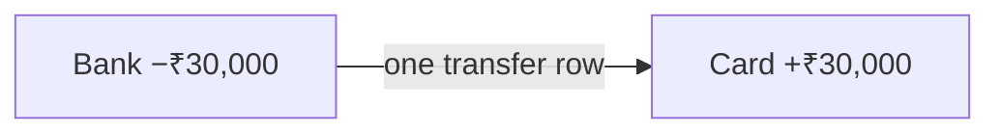
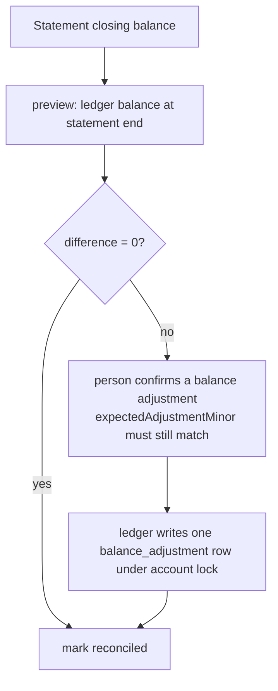

# Transaction processing

Money is integer minor units in `BIGINT`, `bigint` in code, decimal strings in JSON
([ADR 0003](adr/0003-exact-minor-units.md)). Balances are **derived** (opening balance + active
transactions since the opening date), never stored, so a write cannot leave a balance out of step.
Rules in depth: [../database-design.md §3](../database-design.md#3-transaction-types-and-balance-calculation).

## 5. Creating a transaction (account locking)

```mermaid
sequenceDiagram
  autonumber
  participant C as Client
  participant S as TransactionsService
  participant L as Ledger (one DB transaction)
  participant D as PostgreSQL
  C->>S: create(input, Idempotency-Key)
  S->>L: inLedger(work)
  L->>D: SELECT … FROM accounts WHERE id IN (…) AND user_id = $me FOR UPDATE (id order)
  L->>L: ownership, archived?, currency, credit limit, date ≥ opening date, category kind
  L->>D: INSERT transactions (idempotency_key unique per user)
  L->>D: INSERT automation event (budget re-check) — commits with the money or not at all
  D-->>S: COMMIT
  S-->>C: 201 item  (same key again → 200 with the first item; different body → 409)
```

- Locks are taken in a global order (linked rows, then accounts by ID), so concurrent writes queue
  instead of deadlocking. Measured: 400 concurrent creates over 10 accounts, all exact
  ([scalability-and-performance.md](scalability-and-performance.md)).
- An aborted request either commits fully or not at all; the client retries with the same
  idempotency key and never records twice.

## 6. Transfers

A transfer is **one row** (`type = transfer`, `account_id` → `transfer_account_id`) — never two
rows that could drift apart ([ADR 0006](adr/0006-single-row-transfers.md)). Both accounts are
locked; a CHECK constraint requires a different destination and no category; same currency is
enforced by the service. Transfers never count as income or spending.



## 7. Statement import

```mermaid
stateDiagram-v2
  [*] --> uploaded: POST /imports (CSV ≤ limit, rate limited, parsed as untrusted text)
  uploaded --> mapped: columns, date and amount formats
  mapped --> reviewing: rows normalised; duplicates matched (exact + near) against the ledger
  reviewing --> reviewing: approve / skip / mark not-duplicate per row
  reviewing --> importing: commit approved rows
  importing --> completed: each row recorded through the ledger (idempotent per row)
  reviewing --> cancelled
  completed --> reconciled: optional statement reconciliation
```



Each approved row is recorded through `TransactionsService.recordLinked`: the import row is
locked first and remembers the transaction it created (`imported_transaction_id`), so a retried
or concurrent commit returns the earlier transaction instead of recording it twice.

## 8. Statement reconciliation



## Settling a scheduled payment with an existing transaction (Phase 12)

A bill paid outside CalmCash's "Record" button (typed in, or imported from a statement) used to
stay overdue **and** count as everyday spending in forecasts. `POST /recurring/:id/occurrences/
:date/link { transactionId }` now settles the occurrence with that transaction:

```mermaid
sequenceDiagram
  participant C as Client
  participant R as RecurringService
  participant D as PostgreSQL (one transaction)
  C->>R: link(scheduleId, date, transactionId)
  R->>D: lock schedule FOR UPDATE (owner check)
  R->>D: occurrence already recorded? same tx → 200 replay; other tx → 409
  R->>D: lock transaction FOR UPDATE (owner check)
  R->>R: active? same type & currency? within 45 days of the scheduled/due date?
  R->>D: transaction settles another occurrence? → 409
  R->>D: upsert occurrence state=recorded, transaction_id (UNIQUE)
  R->>D: advance the schedule cursor
  R-->>C: 201 occurrence + transaction (no money moved, no new row)
```

`GET …/link-candidates` ranks the person's unlinked, active, same-type, same-currency
transactions in the window by closest amount, then closest date (in SQL, so many small recent
entries cannot hide the real payment). Forecast history already treats transactions joined to an
occurrence as scheduled, so linking removes the double count. Lock order is schedule → transaction,
the same direction as recording, so no cycle exists.
